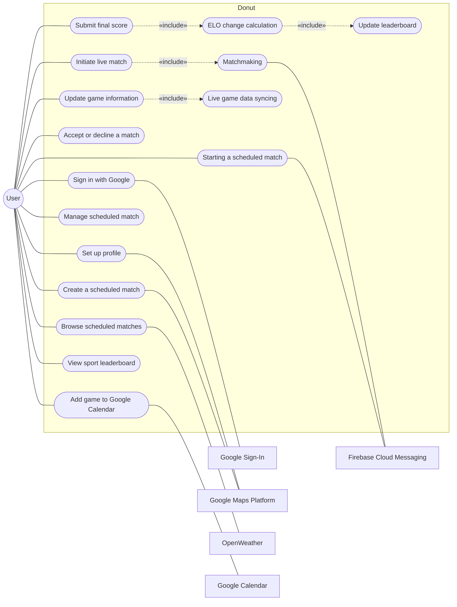
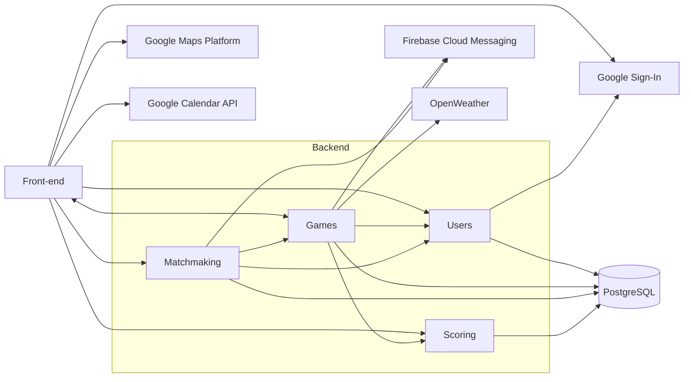
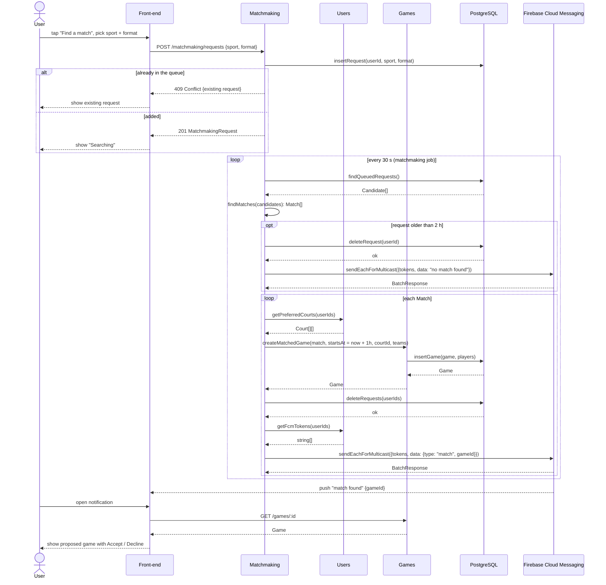
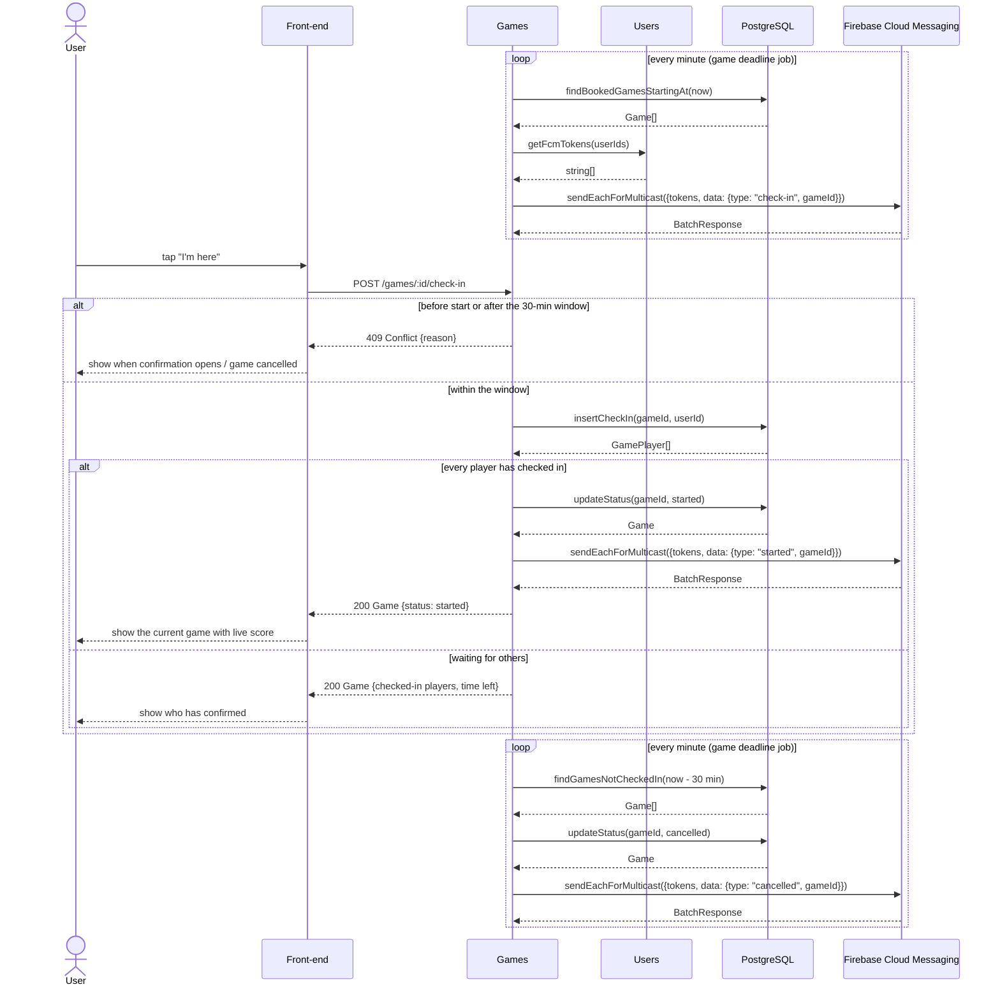
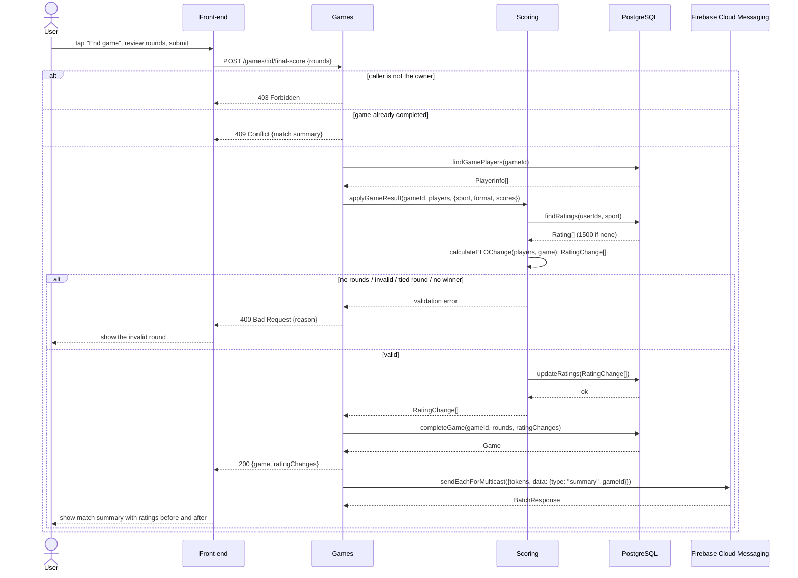
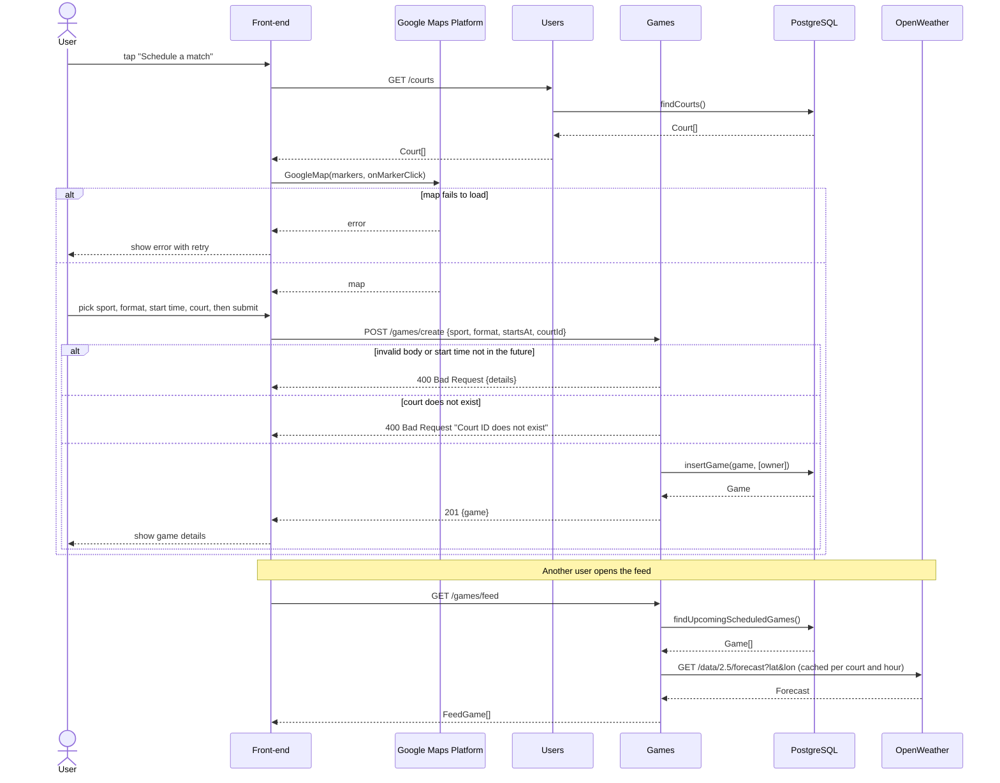
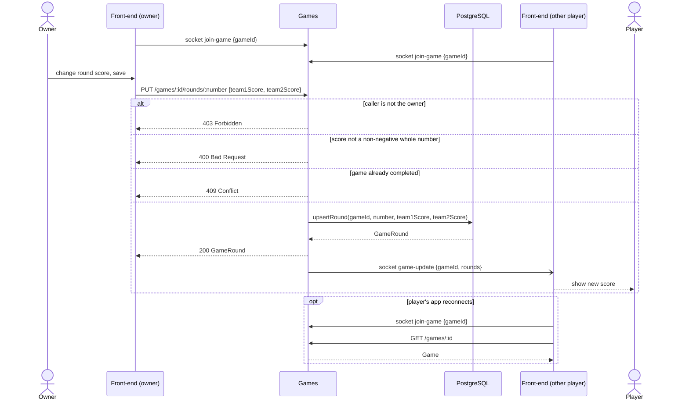

# Requirements and Design

## 1. Change History

| **Change Date**   | **Modified Sections** | **Rationale** |
| ----------------- | --------------------- | ------------- |
| 2026-10-19 | All | Initial version |
| 2026-10-19 | 2, 3.2, 3.3, 3.4, 3.5, 4.3, 4.5, 4.6 | Shortened the project description to 2 paragraphs. Replaced use cases with no actor goal by the user goals that include them (Initiate live match, Submit final score). Renamed use cases to verb phrases. Added the interfaces we call on external modules. Gave every database and external call in the sequence diagrams its parameters and return values. |

---

## 2. Project Description

Donut is an instant matchmaking and ranking app for people who play competitive racket sports (tennis, pickleball and badminton, in singles and doubles) but can't commit to a weekly league. A player can ask for a game right now and the system finds opponents of similar skill, books a court among the players' preferred courts, and notifies everyone. Players can also schedule a game for later and let others join it from a feed. During a game, the score is updated live on every player's phone, and when the game ends each player's per-sport ELO rating changes based on the result and the margin of victory.

The target users are recreational players in a city who want a game this week without joining a league, ladder or club, and who want a fair opponent and a rating that shows how they are improving.

---

## 3. Requirements Specification

### **3.1. List of Features**

#### **Authentication**
User will be able to login using their google account. After the first login, the user sets up their profile by picking their preferred courts on a Google Map; they can edit them later.

#### **Live matchmaking**
User can initiate live matchmaking by choosing a sport and a format (singles, doubles or either). Our system matches players of a similar rating, books a game one hour later at a court from the players' preferred courts, and notifies everyone. The game is booked once every player accepts.

#### **Schedule match**
User can schedule a match in a future time and
the open match will show up in the feed, with the weather forecast for that time. Players can join it from the feed and add it to their Google Calendar.

#### **Live game info update**
During an active game, game information like
time/rounds/score will be updated by one person and sync across all devices that joined this match.

#### **Sports specific ranking**
An ELO based sports specific ranking system to
see your skill level compared to others.

**Project scope requirements:**
- **External API**: *Schedule match* and *Authentication* use Google Maps to pick courts; *Schedule match* uses OpenWeather and Google Calendar.
- **External event**: *Live matchmaking* and *Live game info update* change the app's state when another player acts (a match notification through Firebase Cloud Messaging, a score update through a live connection).
- **Our own computation**: *Live matchmaking* (the matching algorithm) and *Sports specific ranking* (ELO with margin of victory).

### **3.2. Use Case Diagram**

External services are connected with plain lines (no arrows) because they support use cases but never start one. *Matchmaking*, *Live game data syncing*, *ELO change calculation* and *Update leaderboard* are done by the system, so they have no actor of their own; they are included in the user goals that trigger them.

### **3.3. Actors Description**
1. **User**: a recreational racket-sport player who signs in with Google, joins or accepts games, and enters the score of the games they own. The game owner is a User with extra permissions on that one game, not a separate role.
2. **Google Sign-In** *(external service)*: authenticates players and provides the identity token our backend trusts.
3. **Google Maps Platform** *(external service)*: shows the courts on a map so players can pick preferred courts and the court of a scheduled game.
4. **Firebase Cloud Messaging** *(external service)*: delivers match and game notifications to players' devices.
5. **OpenWeather** *(external service)*: supplies the forecast shown for scheduled games in the feed.
6. **Google Calendar** *(external service)*: stores booked games in the player's own calendar when they ask for it.

### **3.4. Use Case Description**
- Use cases for feature 1: Authentication
1. **Sign in with Google**: User signs in with their Google account, and the server creates their Donut account the first time.
2. **Set up profile**: After the first sign-in, the user picks at least one preferred court on a Google Map. They can change their preferred courts later.

- Use cases for feature 2: Live matchmaking
3. **Initiate live match**: User picks a sport and a format and taps a button, and the server places the player into a queue to be matched. The user can cancel at any time, and the request is removed after 2 hours without a match.
4. **Matchmaking**: Every 30 seconds, the system selects players who share the sport and format and have close ratings, books a game one hour later at a court from their preferred courts, then notifies all of them.
5. **Accept or decline a match**: Each notified player accepts or declines. The first player to accept becomes the game's owner. When all accept, the game is booked. If anyone declines, or has not accepted 30 minutes before the start, the match is cancelled for everyone, and the players who did accept go back into the queue.

- Use cases for feature 3: Schedule match
6. **Create a scheduled match**: User creates a scheduled match with sports type, format, court (picked on a Google Map) and start time, and becomes its owner.
7. **Browse scheduled matches**: A separate feed that shows all the upcoming scheduled games and relevant game information like other players' ELO rating, format, sports type, court information and the weather forecast.
8. **Manage scheduled match**: User can join a scheduled match in the feed, and they can leave the game unless it starts in less than 30 minutes. The owner of the scheduled game can also delete the game at any time.
9. **Add game to Google Calendar**: User adds a booked game to their Google Calendar with its court and start time.
10. **Starting a scheduled match**: User can confirm they are present within 30 minutes after the starting time of the game. A game can only be started if all players confirm they are present within 30 minutes after the starting time, otherwise the game is cancelled automatically. Booked matched games start the same way.

- Use cases for feature 4: Live game info update
11. **Update game information**: The owner of the game can update score and round information using the app.
12. **Live game data syncing**: Live game information like score and rounds is updated across all devices that joined the game.

- Use cases for feature 5: Sports specific ranking
13. **Submit final score**: The game owner ends the game and submits the final score, and every player sees the match summary with their rating change.
14. **ELO change calculation**: When the final score is submitted, the system calculates each player's ELO change and saves it to the match summary.
15. **Update leaderboard**: The system applies the ELO changes to the sport's leaderboard.
16. **View sport leaderboard**: User views the leaderboard for a sport, which ranks players by their ELO for that sport.

### **3.5. Formal Use Case Specifications (5 Most Major Use Cases)**

#### Use Case 1: Initiate live match

**Description**: A user asks to be matched for a sport and format. The system puts them in the matchmaking queue, finds players with a close rating, books a court and a start time for them, and notifies everyone.

**Primary actor(s)**: User

**Preconditions**: The user is signed in and has set up their profile, so they have at least one preferred court.

**Postconditions**: A proposed game exists with the sport, format, start time (one hour after the match was found), court and teams set, and every matched player in it. The matched players are no longer in the queue, and each one can accept or decline the game (*Accept or decline a match*).

**Main success scenario**:
1. The user opens the Play tab and taps "Find a match".
2. The system shows a form for sport and format (singles, doubles or either).
3. The user picks a sport and a format and submits the form.
4. The system adds the user to the matchmaking queue and shows a "Searching" status.
5. Every 30 seconds, the system looks for enough queued players (2 for singles, 4 for doubles) who want the same sport and a compatible format ("either" fits both). It takes the longest-waiting player first and groups them with the closest-rated players. The ratings in a group must be within 200 points for singles and 400 points for doubles.
6. The system creates a proposed game that starts one hour from now, at a preferred court all the players share, or else at the court closest to all of their preferred courts. For doubles, it balances the teams: the highest- and lowest-rated players against the middle two. The players are taken out of the queue.
7. The system sends a match notification to every player in the game through Firebase Cloud Messaging.
8. The user opens the notification. The system shows the proposed game (sport, format, court, start time, the other players' ratings) with Accept and Decline buttons.

**Failure scenario(s)**:
- 4a. The user is already in the matchmaking queue.
    - 4a1. The system rejects the new request and shows the existing one.
    - 4a2. The user can cancel the existing request and submit the new one.

- 4b. The server cannot be reached.
    - 4b1. The app shows an error, and the user is not added to the queue.
    - 4b2. The user can retry the submission.

- 5a. No compatible players are in the queue yet.
    - 5a1. The user stays in the queue with the "Searching" status, and the system tries again every 30 seconds.
    - 5a2. If there is still no match after 2 hours, the system removes the request and notifies the user that no match was found. The user can join the queue again.

- 5b. The user cancels the search before a match is found.
    - 5b1. The system removes the user from the queue, and no game is proposed.

- 7a. A player's device cannot receive the notification (it is offline or has no notification token).
    - 7a1. The proposed game stays stored on the server.
    - 7a2. The system shows the proposed game the next time that player opens the app. The acceptance deadline (30 minutes before the start) still applies.

#### Use Case 2: Starting a scheduled match
**Description**: When a booked game reaches its start time, each player confirms they are at the court. If every player confirms within 30 minutes after the start time, the system starts the game. Otherwise, it cancels the game. Booked matched games start the same way.

**Primary actor(s)**: User

**Preconditions**: The user is signed in and is a player in a booked game (every spot filled) that has not started.

**Postconditions**: On success, the game has started and appears as the current game on every player's Play tab, where its owner can update the score. If any player does not confirm in time, the game is cancelled for everyone and no ratings change.

**Main success scenario**:
1. At the game's start time, the system sends every player a notification through Firebase Cloud Messaging, asking them to confirm they are present.
2. The user opens the game from the notification or the Play tab and taps "I'm here".
3. The system records the confirmation. It shows which players have confirmed and how much time is left to confirm.
4. Each of the other players confirms in the same way (steps 2–3).
5. When the last player confirms, the system starts the game and notifies every player that it has started.
6. The system shows the game as the current game on each player's Play tab, with its live score. The game owner can now update the score (*Update game information*).

**Failure scenario(s)**:
- 1a. A scheduled game still has open spots at its start time.
    - 1a1. The system cancels the game.
    - 1a2. The system notifies the players who joined that the game was cancelled because it did not fill.

- 1b. A player's device cannot receive the notification (it is offline or has no notification token).
    - 1b1. The player can still open the game from the Play tab and confirm (step 2).
    - 1b2. The 30-minute confirmation deadline still applies.

- 2a. The user taps "I'm here" before the start time.
    - 2a1. The system does not record the confirmation and shows when confirmation opens.

- 2b. The user tries to confirm after the 30-minute window has ended.
    - 2b1. The system does not record the confirmation and shows that the game was cancelled.

- 3a. The server cannot be reached.
    - 3a1. The app shows an error, and the confirmation is not recorded.
    - 3a2. The user can retry while the confirmation window is still open.

- 4a. A player has not confirmed 30 minutes after the start time.
    - 4a1. The system cancels the game for everyone.
    - 4a2. The system notifies every player that the game was cancelled because not all players confirmed. No ratings change.

- 4b. The game owner deletes the game before every player has confirmed.
    - 4b1. The system cancels the game and notifies every other player that the owner deleted it.

#### Use Case 3: Submit final score
**Description**: When the game owner submits the final score, the system decides the winner and calculates each player's ELO change for that sport. It then saves the changes to the match summary and applies them to the sport's leaderboard.

**Primary actor(s)**: User

**Preconditions**: The user is signed in and is a player in a game that has started and has no final score.

**Postconditions**: The game is completed and its final score can no longer be changed. Each player's rating for the sport is updated, the match summary shows each player's rating before and after, and the sport's leaderboard reflects the new ratings.

**Main success scenario**:
1. The game owner taps "End game" on the current game in the Play tab.
2. The system shows the rounds recorded during the game as the final score.
3. The owner reviews the final score, corrects any round if needed, and submits it.
4. The system validates the score and decides the winner: the side that won more rounds.
5. The system reads every player's rating for the sport. A player with no rating in that sport yet starts at 1500.
6. The system calculates the rating change using ELO with margin of victory and the sport's parameters (§7 of the Product Design). In doubles, each team is rated by its players' average rating, and each player receives half of the team's change.
7. The system saves the final score, the new ratings and each player's rating change to the match summary, marks the game as completed, and updates the sport's leaderboard (*Update leaderboard*).
8. The system notifies every player through Firebase Cloud Messaging and shows the match summary with each player's rating before and after the game.

**Failure scenario(s)**:
- 1a. The final score was already submitted.
    - 1a1. The system shows the match summary read-only, and the score cannot be submitted again.

- 1b. The user is not the game owner.
    - 1b1. The Play tab shows the live score without the "End game" button.
    - 1b2. The user sees the match summary once the owner submits the score (step 8).

- 4a. The score has no rounds.
    - 4a1. The system rejects the submission and asks the owner to enter at least one round (step 3).

- 4b. A round score is not a non-negative whole number.
    - 4b1. The system rejects the submission, says which round is invalid, and the owner corrects it (step 3).

- 4c. A round is tied.
    - 4c1. The system rejects the submission, highlights the tied round, and the owner corrects it (step 3).

- 4d. Both sides won the same number of rounds, so there is no winner.
    - 4d1. The system rejects the submission and explains that the match needs a winner. The owner corrects the score (step 3).

- 7a. Saving the score or the ratings fails.
    - 7a1. The system saves nothing: the score, the ratings and the leaderboard are saved together or not at all.
    - 7a2. The app shows an error, and the owner can retry the submission.

- 8a. A player's device cannot receive the notification.
    - 8a1. The system shows the match summary the next time that player opens the app.

#### Use Case 4: Create a scheduled match
**Description**: A user creates a game for a future time by choosing the sport, format, start time and a court on a Google Map. The game appears in the feed so other players can join it.

**Primary actor(s)**: User

**Preconditions**: The user is signed in.

**Postconditions**: An open scheduled game exists with the user as its owner and first player, and it appears in every user's feed until it is full, deleted or started.

**Main success scenario**:
1. The user opens the Play tab and taps "Schedule a match".
2. The system shows a form for sport, format and start date and time, and a Google Map with the courts as markers.
3. The user fills in the sport, format and start time, and taps a court marker.
4. The system shows the selected court's name.
5. The user submits the form.
6. The system validates the game and creates it with the user as owner and first player.
7. The system shows the game's details, and the game appears in the feed for other users with its weather forecast.

**Failure scenario(s)**:
- 2a. The map cannot be loaded (no connection, or Google Maps returns an error).
    - 2a1. The app shows an error with a retry button, and the form cannot be submitted without a court.
    - 2a2. The user retries, and the scenario continues at step 2.

- 6a. The start time is not in the future.
    - 6a1. The system rejects the game and explains that the start time must be in the future.
    - 6a2. The user picks a new start time (step 3).

- 6b. The selected court is not in the system.
    - 6b1. The system rejects the game and asks the user to pick another court (step 3).

- 6c. The server cannot be reached.
    - 6c1. The app shows an error, keeps the form filled in, and the user can retry.

- 7a. The weather forecast cannot be loaded.
    - 7a1. The feed shows the game without a forecast.

#### Use Case 5: Update game information
**Description**: During a started game, the owner enters each round's score. The system saves it and pushes the update to every other player in the game in real time.

**Primary actor(s)**: User

**Preconditions**: The user is signed in and is a player in a game that has started and has no final score.

**Postconditions**: The new score is stored, and every player with the game open sees the same score.

**Main success scenario**:
1. The owner opens the current game in the Play tab.
2. The system shows the rounds so far with score controls, and the app connects to the game's live updates.
3. The owner changes the current round's score, or starts a new round, and saves it.
4. The system validates the score and stores the round.
5. The system sends the update to every player connected to the game.
6. Each other player's app shows the new score without refreshing.

**Failure scenario(s)**:
- 1a. The user is not the game owner.
    - 1a1. The app shows the live score read-only and receives updates (step 6).

- 4a. A score is not a non-negative whole number.
    - 4a1. The system rejects the update, and the owner corrects it (step 3).

- 4b. The game already has a final score.
    - 4b1. The system rejects the update and shows the match summary.

- 4c. The server cannot be reached.
    - 4c1. The app shows an error and keeps the unsaved score on screen.
    - 4c2. The owner can retry when the connection returns.

- 5a. A player's app is not connected (offline or closed).
    - 5a1. When the app reconnects, it rejoins the game's live updates and loads the latest score from the server.

### **3.6. Screen Mock-ups**
Not included. The formal use cases describe each screen in enough detail for this version.

### **3.7. Non-Functional Requirements**

1. **Live score sync latency**
    - **Description**: 95% of score updates are shown on every other connected player's device within 1 second of the owner saving them.
    - **Justification**: Players at the court check the score between points, so a late update makes the app look wrong and people stop trusting it. 1 second is the limit for a user's flow of thought to stay uninterrupted (Nielsen Norman Group). The 95th percentile keeps one slow device from defining the metric.

2. **API response time**
    - **Description**: 95% of REST requests (feed, create, join, accept, score) respond within 500 ms with 50 concurrent users.
    - **Justification**: Players open the app right before playing, often on mobile data, so every screen should load in well under the 1-second flow limit; 500 ms leaves room for the mobile network on top. 50 concurrent users is above the load we expect for the first version in one city.

3. **Match found latency**
    - **Description**: When compatible players are in the matchmaking queue, 95% of them are matched and notified within 60 seconds of the last compatible player joining.
    - **Justification**: Live matchmaking is the core of the app: the players want to play within the hour, and they have only 30 minutes to accept. The matchmaking job runs every 30 seconds, so 60 seconds allows one missed run plus notification delivery.

---

## 4. Designs Specification
### **4.1. Main Components**
1. **Users**
    - **Purpose**: Owns player accounts, Google sign-in, preferred courts, the courts list and device notification tokens.
    - **Rationale**: Everything that answers "who is this player and where do they play" lives in one place. Other components only read it. Alternative considered: putting profile data in the auth flow. Rejected because authentication is delegated to Google and owns no data of its own.
    - **Interfaces**:
        1. `POST /user/login` with `{ idToken: string }` → `{ user: User }` - E
            - **Purpose**: Verifies the Google ID token and returns the player's account, creating it on the first sign-in. Every other request carries the Google ID token in the `Authorization` header and is verified the same way.
        2. `GET /courts` → `Court[]` - E
            - **Purpose**: Returns every court with its location, to show as markers on the map.
        3. `PUT /user/me/courts` with `{ courtIds: number[] }` → `Court[]` - E
            - **Purpose**: Replaces the player's preferred courts (profile setup and later edits).
        4. `PUT /user/me/fcm-token` with `{ fcmToken: string }` → `204` - E
            - **Purpose**: Registers the device that receives the player's notifications.
        5. `Court[][] getPreferredCourts(userIds: string[])` - In
            - **Purpose**: Used by Matchmaking to choose the court of a matched game.
        6. `string[] getFcmTokens(userIds: string[])` - In
            - **Purpose**: Used by Matchmaking and Games to send notifications.
2. **Games**
    - **Purpose**: Owns games, their players, rounds and lifecycle: create, feed, join, leave, delete, accept, check-in, live score and final score. It also runs the deadline jobs (acceptance and check-in) and the live connection for score updates.
    - **Rationale**: A game is the unit of record: its players, status and rounds change together, so they stay in one component. Alternative considered: a separate live-score component. Rejected because the score is part of the game and would need the same data and the same checks.
    - **Interfaces**:
        1. `POST /games/create` with `{ sport, format, startsAt, courtId }` → `201 { game: Game }` - E
            - **Purpose**: Creates a scheduled game owned by the caller.
        2. `GET /games/feed` → `FeedGame[]` (game, players' ratings, forecast) - E
            - **Purpose**: Returns the upcoming scheduled games for the feed.
        3. `GET /games/:id` → `Game` - E
            - **Purpose**: Returns one game with its players, status and rounds.
        4. `POST /games/:id/join` → `Game`, `POST /games/:id/leave` → `204`, `DELETE /games/:id` → `204` - E
            - **Purpose**: Join or leave a scheduled game; the owner deletes it.
        5. `POST /games/:id/accept` → `Game`, `POST /games/:id/decline` → `204` - E
            - **Purpose**: Accept or decline a matched game.
        6. `POST /games/:id/check-in` → `Game` - E
            - **Purpose**: Confirms the player is at the court; starts the game when every player has confirmed.
        7. `PUT /games/:id/rounds/:number` with `{ team1Score, team2Score }` → `GameRound` - E
            - **Purpose**: The owner saves one round's live score.
        8. Socket.IO `join-game { gameId }` (client → server) and `game-update { gameId, rounds }` (server → client) - E
            - **Purpose**: Pushes each saved round to every player connected to the game.
        9. `POST /games/:id/final-score` with `{ rounds: RoundScore[] }` → `{ game: Game, ratingChanges: RatingChange[] }` - E
            - **Purpose**: The owner ends the game; triggers the rating update.
        10. `Game createMatchedGame(match: Match, startsAt: Date, courtId: number, teams: string[][])` - In
            - **Purpose**: Used by Matchmaking to create a proposed game.
3. **Matchmaking**
    - **Purpose**: Owns the matchmaking queue and the matching algorithm, run by a background job every 30 seconds.
    - **Rationale**: Matching creates games without any player asking at that moment, so it runs on a timer, outside the request path. Alternative considered: matching inside Games when a request arrives. Rejected because it would put a slow, scheduled job in the request-serving component and make join requests race each other.
    - **Interfaces**:
        1. `POST /matchmaking/requests` with `{ sport, format }` → `201 MatchmakingRequest` - E
            - **Purpose**: Puts the caller in the queue.
        2. `GET /matchmaking/requests/me` → `MatchmakingRequest` - E
            - **Purpose**: Returns the caller's request, to show the "Searching" status.
        3. `DELETE /matchmaking/requests/me` → `204` - E
            - **Purpose**: Takes the caller out of the queue.
        4. `Match[] runMatchmaking()` - In
            - **Purpose**: Called by the matchmaking job: reads the queue, finds matches, creates games and notifies players. It also removes requests older than 2 hours.
4. **Scoring**
    - **Purpose**: Owns per-sport ratings, the ELO calculation (with margin of victory and doubles team averages) and the leaderboards.
    - **Rationale**: This is our own computation. It is a pure function that is easy to unit test, and it is the only code allowed to change ratings. Alternative considered: ratings as columns that Games updates directly. Rejected because Matchmaking and the feed also read ratings, and only one component should write them.
    - **Interfaces**:
        1. `RatingChange[] applyGameResult(gameId: string, players: PlayerInfo[], game: GameInfo)` - In
            - **Purpose**: Called by Games inside the final-score transaction: calculates and stores the new ratings.
        2. `RatingChange[] calculateELOChange(players: PlayerInfo[], game: GameInfo)` - In
            - **Purpose**: The pure ELO calculation used by `applyGameResult`.
        3. `Map<string, number> getRatings(userIds: string[], sport: Sport)` - In
            - **Purpose**: Used by Games to show players' ratings in the feed and in a proposed game.
        4. `GET /leaderboard/:sport` → `LeaderboardEntry[]` - E
            - **Purpose**: Returns the players ranked by rating for one sport.

### **4.2. Databases**
1. **PostgreSQL (`donut`)**
    - **Purpose**: Stores users, per-sport ratings, courts, preferred courts, the matchmaking queue, games, game players and rounds (`backend/prisma/schema.prisma`).
    - **Rationale**: The data is relational: a match joins the queue with ratings and courts, and a game joins players and rounds. One relational database keeps those joins in single queries and lets a match or a final score be saved in one transaction. Alternative considered: MongoDB. Rejected because nothing here is document-shaped, and we would lose transactions across collections.

### **4.3. External Modules**
1. **Google Sign-In**
    - **Purpose**: Signs players in on Android and issues the ID token the backend verifies.
    - **Rationale**: The course requires external authentication, and storing passwords ourselves would be less secure for no benefit.
    - **Interfaces we call**:
        1. `LoginTicket verifyIdToken({ idToken: string, audience: string })` (google-auth-library) - called by Users
            - **Purpose**: Checks the ID token's signature and audience and returns the player's Google profile.
        2. `GoogleIdTokenCredential getCredential(GetGoogleIdOption)` (Credential Manager) - called by the front-end
            - **Purpose**: Signs the player in on the device and returns the ID token sent to `POST /user/login`.
2. **Google Maps Platform (Maps SDK for Android)**
    - **Purpose**: Shows the courts as markers so players can pick preferred courts and the court of a scheduled game.
    - **Rationale**: Players recognise courts by where they are, not by name. The courts themselves are stored in our database, so the map is only used for display and picking.
    - **Interfaces we call**:
        1. `GoogleMap(markers: Marker[], onMarkerClick)` (Maps Compose) - called by the front-end
            - **Purpose**: Shows the courts as markers and reports which one the player picks.
3. **Firebase Cloud Messaging**
    - **Purpose**: Delivers match, game start, cancellation and match summary notifications, even when the app is closed.
    - **Rationale**: It is the standard push service for Android and needs no polling.
    - **Interfaces we call**:
        1. `BatchResponse sendEachForMulticast({ tokens: string[], data: Map<string, string> })` (firebase-admin) - called by Games and Matchmaking
            - **Purpose**: Sends one notification to every device of the players in a game.
4. **OpenWeather**
    - **Purpose**: Supplies the forecast for a scheduled game's court and time, shown in the feed.
    - **Rationale**: Most courts are outdoors, so the weather decides whether a game happens. Free tier is enough for our load.
    - **Interfaces we call**:
        1. `GET /data/2.5/forecast?lat={lat}&lon={lon}` → `Forecast` (3-hour steps for 5 days) - called by Games
            - **Purpose**: Gets the forecast at the court; Games picks the step closest to the game's start time.
5. **Google Calendar API**
    - **Purpose**: Adds a booked game to the player's own Google Calendar.
    - **Rationale**: Players already use Google accounts to sign in, so they can add the game to their own calendar without a separate account.
    - **Interfaces we call**:
        1. `POST /calendars/primary/events` with `{ summary, location, start, end }` → `Event` - called by the front-end
            - **Purpose**: Adds the booked game to the player's own calendar.

### **4.4. Frameworks and Libraries**
Libraries marked *(planned)* are part of the design but not in the code yet.

1. **Express 5**
    - **Purpose**: HTTP server and routing for the REST API.
    - **Reason**: Minimal and widely used for Node.js. Its routes → controllers → services → repositories structure matches the course's reference architecture.
2. **Prisma 7 (with `@prisma/adapter-pg`) and PostgreSQL 17**
    - **Purpose**: Database schema, migrations and typed queries.
    - **Reason**: Queries are type-checked against the schema, and migrations make the database reproducible on any machine.
3. **TypeScript 5.9 and tsx**
    - **Purpose**: Backend language and development runner.
    - **Reason**: Catches interface mismatches between components at compile time.
4. **node-cron**
    - **Purpose**: Runs the matchmaking job every 30 seconds and the deadline jobs.
    - **Reason**: Small, in-process scheduler with a no-overlap option, so one run never starts while the last is still going.
5. **google-auth-library**
    - **Purpose**: Verifies Google ID tokens on the backend.
    - **Reason**: Google's official library; it checks the token signature and audience for us.
6. **zod** *(planned)*
    - **Purpose**: Validates request bodies.
    - **Reason**: One schema gives both the runtime check and the TypeScript type.
7. **Socket.IO** (server and Android client) *(planned)*
    - **Purpose**: Live score updates in a room per game.
    - **Reason**: Keeps one connection open per player, so updates arrive without polling. It reconnects automatically and supports rooms out of the box.
8. **firebase-admin** *(planned)*
    - **Purpose**: Sends Firebase Cloud Messaging notifications from the backend.
    - **Reason**: Google's official server SDK for FCM.
9. **Jest 30, ts-jest and Supertest**
    - **Purpose**: Backend unit, integration and non-functional tests.
    - **Reason**: Required by the course's testing setup. Supertest calls the Express app directly without starting a server.
10. **Kotlin 2.1 and Jetpack Compose (Material 3)**
    - **Purpose**: The Android app and its UI.
    - **Reason**: The course template's pinned toolchain, which builds on the TAs' machines.
11. **Retrofit and OkHttp** *(planned)*
    - **Purpose**: HTTP client for the backend API.
    - **Reason**: The standard typed REST client on Android.
12. **Credential Manager (Sign in with Google)** *(planned)*
    - **Purpose**: Google sign-in on Android.
    - **Reason**: Google's current recommended sign-in API on Android.
13. **Maps Compose** *(planned)*
    - **Purpose**: Google Maps inside Compose screens.
    - **Reason**: Google's official Compose wrapper for the Maps SDK.
14. **Firebase Messaging (Android)** *(planned)*
    - **Purpose**: Receives push notifications on the device.
    - **Reason**: The client side of FCM.

### **4.5. Dependencies Diagram**

`A --> B` means A calls B through at least one interface defined in B (§4.1, §4.3). `Front-end <--> Games` goes both ways: the front-end calls the Games REST API, and Games calls the front-end's `game-update` Socket.IO handler to push live scores.

### **4.6. Use Case Sequence Diagram (5 Most Major Use Cases)**
1. [**Initiate live match**](#uc1)

2. [**Starting a scheduled match**](#uc2)

3. [**Submit final score**](#uc3)

4. [**Create a scheduled match**](#uc4)

5. [**Update game information**](#uc5)

### **4.7. Design of Non-Functional Requirements**
1. [**Live score sync latency**](#nfr1)
    - **Implementation**: Every player with a game open joins that game's Socket.IO room. When the owner saves a round, Games writes it to the database and immediately emits `game-update` to the room over connections that are already open, so there is no polling and no new connection per update. An app that reconnects loads the latest score with `GET /games/:id`.
2. [**API response time**](#nfr2)
    - **Implementation**: The columns we filter on most (user, court, game) are indexed. The feed loads games, players and ratings in one query instead of one per game. Forecasts are cached per court and hour, so the feed rarely waits on OpenWeather. Matchmaking runs in a background job, outside the request path.
3. [**Match found latency**](#nfr3)
    - **Implementation**: The matchmaking job runs every 30 seconds with no overlap between runs. The greedy matcher sorts each sport and format queue once, so a run takes milliseconds for our expected queue sizes. Each match is saved in its own transaction, and the notifications are sent right after it commits.
