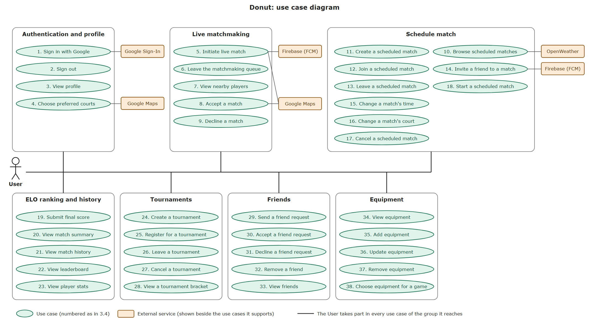
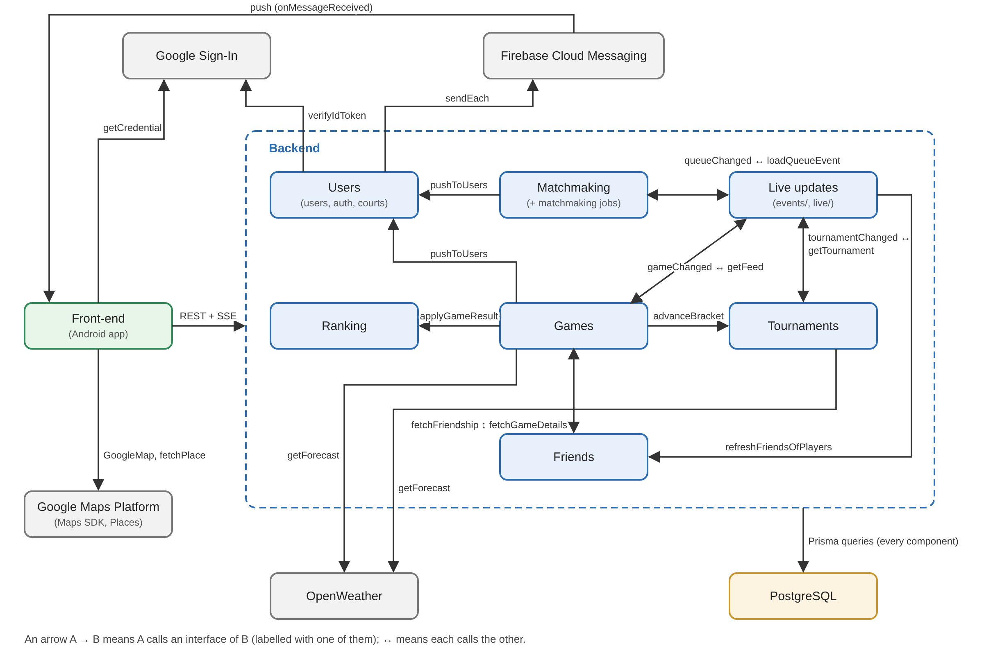
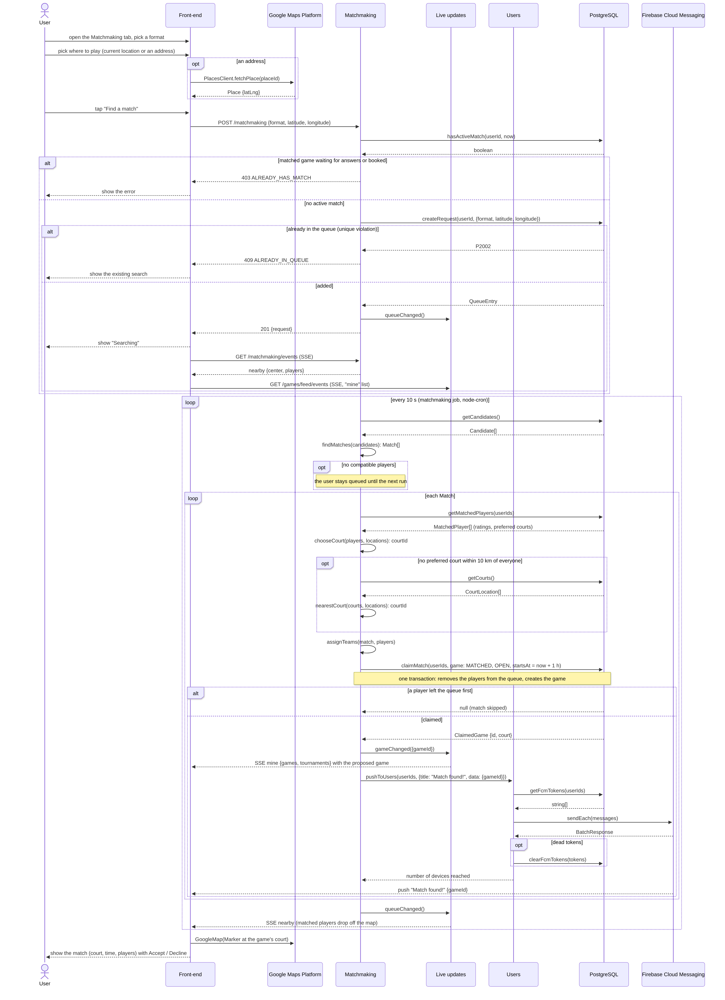
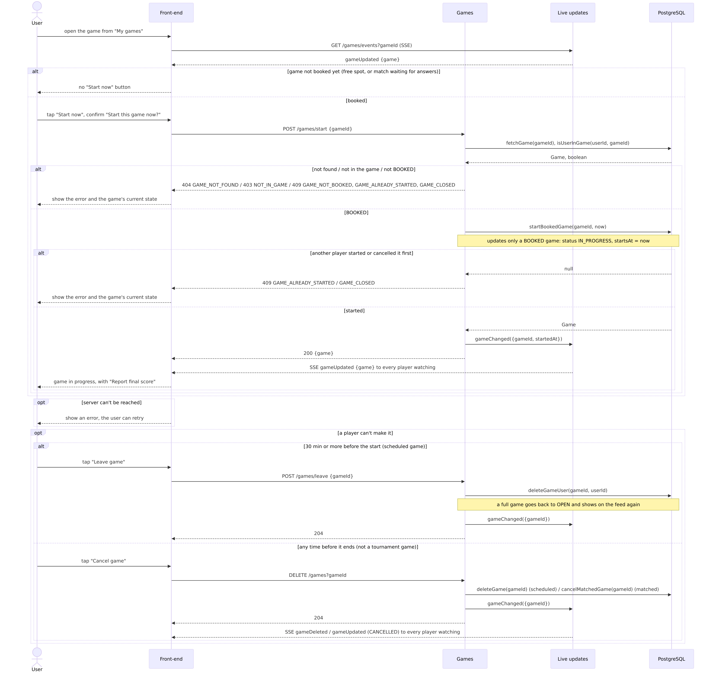
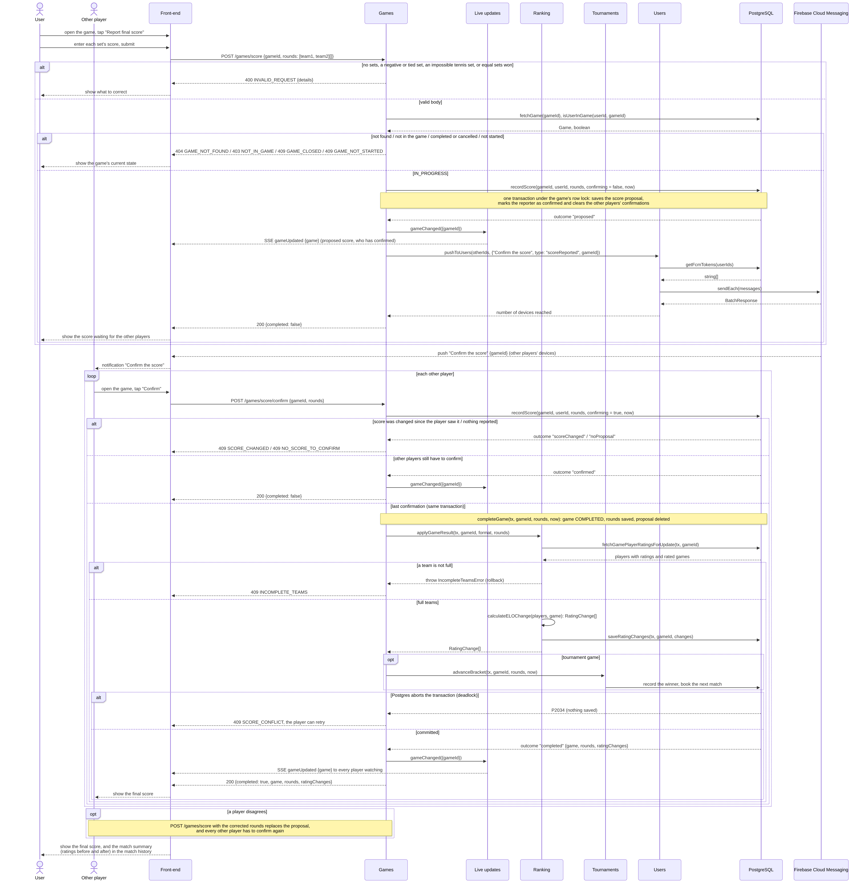
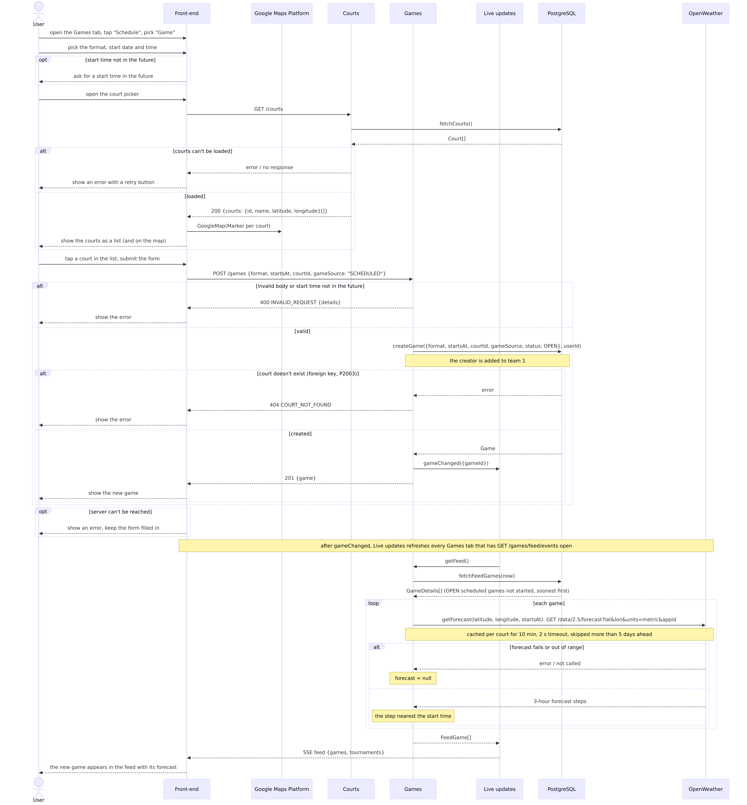
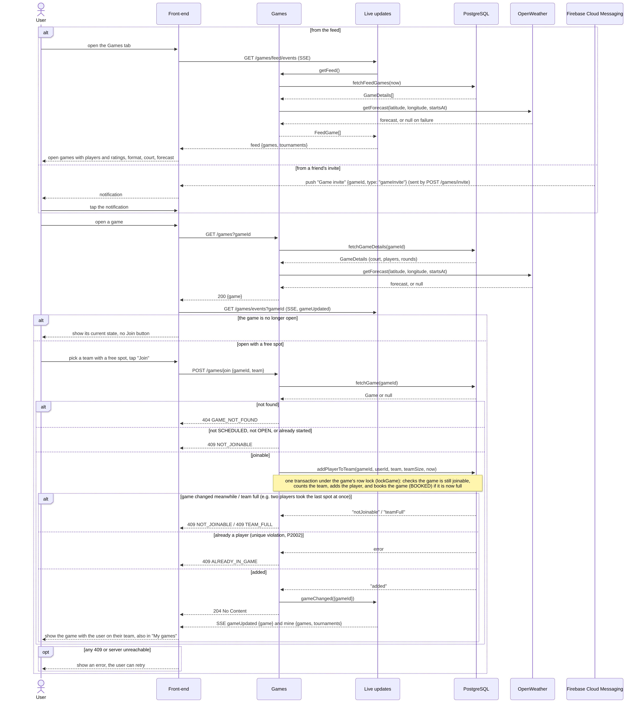

# Requirements and Design

## 1. Change History

| **Change Date** | **Modified Sections** | **Rationale** |
| --------------- | --------------------- | ------------- |
| Oct 23, 2026 | 2, 3.1, 3.3–3.5, 4.1, 4.2, 4.7 | Narrowed the first version to tennis only; players no longer pick a sport. |
| Oct 28, 2026 | 4.1 | Added the Games interfaces that change a game's time and court, and `POST /games/score`. |
| Nov 1, 2026 | 4.1, 4.3 | Implemented `GET /courts`, `GET /games/feed` (with forecasts), `GET /games/me` and `GET /games`, and documented the join and leave rules. |
| Nov 1, 2026 | 4.1, 4.2 | `POST /games/score` updates ratings through `applyGameResult`. Removed the leftover `sport` parameters. |
| Nov 1, 2026 | 4.1, 4.2 | Added `GET /leaderboard` and `GET /user/me`. |
| Nov 2, 2026 | 3.1, 3.2, 3.4, 4.1–4.3, 4.5 | Added tournaments: the feature, its use cases, the Tournaments component and its tables. |
| Nov 3, 2026 | 4.1, 4.2 | Added the Friends component and its `friendships` table. |
| Nov 3, 2026 | 4.1 | Added `GET /games/history` and each player's `ratingBefore` and `ratingAfter`. |
| Nov 3, 2026 | 4.1 | Added `POST /games/invite`, and updated `DELETE /games` for matched games. |
| Nov 3, 2026 | All | Shortened the document and matched it to the code: token auth (`/user/refresh`, `/user/logout`), equipment, location-based matchmaking (`/matchmaking`, `POST /games/accept`, the deadline job), no game owner, and the libraries in use. |
| Nov 3, 2026 | 3.1, 3.3, 3.5 (Use Case 4), 4.3 | A scheduled game's court is picked from a list; the map shows a matched game's court. |
| Nov 18, 2026 | 4.1 | The ELO K-factor depends on each player's number of rated games (`calculateKFactor`), counted by `applyGameResult`. |
| Nov 18, 2026 | 3.1, 4.1 | Added player stats: `GET /stats` and the stats screen with the ELO chart. |
| Nov 18, 2026 | 3.4, 3.5 (Use Case 3), 4.1 | Added `POST /games/start` and the game screen's "Start now" button, so players of a booked game can start it before its start time and report the score. |
| Nov 18, 2026 | 4.1 | `GET /games` and `GET /games/me` return each game's forecast too, so the game screen and the caller's games show the weather. |
| Nov 19, 2026 | 4.1 | Live updates over Server-Sent Events for games, the Games tab, tournaments and friends. Games are `IN_PROGRESS` only once started with `POST /games/start`, and only then scored. Friends show the game they are playing. |
| Nov 20, 2026 | 3.5 (Use Case 1), 4.1 | A match no longer depends on its push reaching the app: while searching or answering a match, the app follows the player's live games stream. The queue card's map follows the new `GET /matchmaking/events` stream instead of polling `GET /matchmaking/nearby`, so the app polls nothing during matchmaking. |
| Nov 20, 2026 | 3.1, 3.4, 3.5 (Use Case 3), 4.1, 4.2 | Score confirmation: a reported score waits until every player confirms it (`POST /games/score/confirm`), and a player who disagrees suggests a correction. The game screen shows who has confirmed, live, and the other players get a push asking them to confirm. |
| Nov 20, 2026 | 3.5 (Use Case 3), 4.1 | Set scores: past 6 games a set is won by exactly 2 games, or 7–6 after a tiebreak, so a fabricated 99–0 can't move ratings (the other group's review, see Code_Review.md 3.2). |
| Nov 20, 2026 | 3.7, 4.7 | Added NFR 4, rating accuracy for new players, which `backend/tests/nfr/ratingAccuracy.test.ts` checks. |
| Nov 20, 2026 | 3.1, 3.2, 3.4, 3.5, 4.6 | Reviewer feedback on features and use cases: split use cases that had more than one goal, added the missing user-facing use cases (sign out, profile, leave the queue, decline a match, friends, equipment, match history, stats), moved system-only steps out of the use case list and gave every use case an active, user-focused name. Redrew the use case diagram. |
| Nov 20, 2026 | 3.1, 3.2, 3.3, 3.4, 3.5, 3.7, 4.1, 4.3, 4.6, 4.7 | Every feature that was not yet built is now implemented, so the notes saying so are removed. Removed the live score feature, its use cases and its non-functional requirement: players report the score once after the game. Added a fifth formal use case, Join a scheduled match. |
| Nov 20, 2026 | 3.1, 3.2, 3.3, 3.4, 3.5, 4.1, 4.3, 4.5, 4.6 | Removed Google Calendar and Edit profile (not built). Failure scenarios say what the user sees. Added `GET /user/:userId/photo`. Diagrams matched to the code, plus a Join a scheduled match diagram. Check-in replaced by "Start now" (Use Case 2, Start a scheduled match); players opt out by leaving or cancelling. Courts moved out of Users into their own component. Restored the score confirmation and `GET /matchmaking/events` text lost in a merge. |
| Nov 20, 2026 | 3.1, 3.2, 3.4, 4.1, 4.2 | Equipment tracking: players choose the equipment they use in a game (`PUT /games/equipment`, use case 38), starting with their default items, and each item counts the games and hours it was used. |

---

## 2. Project Description

Donut is a matchmaking and ranking app for recreational tennis players (singles and doubles) who can't commit to a weekly league. A player asks for a game now and the system finds nearby players of similar skill, picks a court and notifies everyone. Players can also schedule games or tournaments for later and let others join from a feed. After each game, every player's ELO rating changes based on the result and the margin of victory.

---

## 3. Requirements Specification

### **3.1. List of Features**

#### **Authentication**
Users sign in with Google. The backend then issues its own access and refresh tokens. Users can sign out, view their profile, and pick their preferred courts on a map.

#### **Live matchmaking**
Users pick a format (singles, doubles or either) and where they want to play. The system matches nearby players with similar ratings, books a game one hour later at a nearby court and notifies everyone. The game is booked once every player accepts.

#### **Schedule match**
Users schedule a game for a future time at a court they pick from a list. It shows in the feed with the weather forecast, and others can join it or be invited by a friend.

#### **ELO ranking**
After every player of a game confirms its final score, every player's ELO rating changes, and a leaderboard ranks players by rating. A player's stats screen shows their ELO over time, their match, set and game totals, and how they do against opponents of different ratings.

#### **Tournaments**
Users create an 8-team single-elimination tournament (singles or doubles) that players register for from the feed. When it fills, the system forms and seeds the teams, draws the bracket and books the quarterfinals. Each confirmed score moves the winner on, up to the champion.

Supporting features: **friends** (requests, friends list, adding players from a match summary), **match history** with a summary per game, and **equipment** tracking (rackets, balls, shoes, with maintenance dates and how many games and hours each was used).

**Project scope requirements:**
- **External API**: Google Maps (picking courts), Google Places (picking where to play), OpenWeather (feed forecasts).
- **External event**: match notifications, game invites and requests to confirm a score through Firebase Cloud Messaging.
- **Our own computation**: the matching algorithm, ELO with margin of victory, and the tournament draw (rating-based seeding, balanced doubles teams, moving winners through the bracket).

### **3.2. Use Case Diagram**

Use cases are numbered as in §3.4. The User takes part in every use case of each group it is joined to. External services support use cases but never start one. Steps the system does alone are not use cases (see §3.4).

### **3.3. Actors Description**
1. **User**: a tennis player who signs in with Google, joins or is matched into games, and reports scores. Every player in a game has the same permissions on it.
2. **Google Sign-In**: authenticates players.
3. **Google Maps Platform**: shows a matched game's court on a map, and Places looks up where a player wants to play.
4. **Firebase Cloud Messaging**: delivers match notifications and game invites.
5. **OpenWeather**: supplies forecasts for the feed.

### **3.4. Use Case Description**
Each use case is one goal of one user, named with an active verb. The numbers match the diagram in §3.2.

- Feature 1: Authentication and profile
1. **Sign in with Google**: The user signs in with their Google account; the server creates their account the first time and returns tokens.
2. **Sign out**: The user signs out, and the server revokes their refresh token.
3. **View profile**: The user views their profile and rating.
4. **Choose preferred courts**: The user picks their preferred courts on a map.

- Feature 2: Live matchmaking
5. **Initiate live match**: The user picks a format and a location (their current location or an address) and joins the queue. The system then looks for a match (see *System steps* below).
6. **Leave the matchmaking queue**: The user leaves the queue at any time before they are matched.
7. **View nearby players**: The user sees the other queued players within 10 km, shown only by approximate location.
8. **Accept a match**: The user accepts a proposed match. When every player has accepted, the game is booked.
9. **Decline a match**: The user declines a proposed match, and it is cancelled for everyone.

- Feature 3: Schedule match
10. **Browse scheduled matches**: The feed lists the upcoming games and tournaments that can be joined, with each game's players and ratings, format, court and forecast.
11. **Create a scheduled match**: The user creates a game with a format, start time and court, and is its first player.
12. **Join a scheduled match**: The user joins an open game from the feed, or from a friend's invite, on the team of their choice.
13. **Leave a scheduled match**: The user leaves a game they joined, unless it starts in less than 30 minutes.
14. **Invite a friend to a match**: The user sends a friend a notification that opens the game, where the friend can join it.
15. **Change a match's time**: A player moves the game to another time.
16. **Change a match's court**: A player moves the game to another court.
17. **Cancel a scheduled match**: A player cancels the game for everyone.
18. **Start a scheduled match**: At the court, a player of a booked game taps "Start now" to start it for everyone, so its score can be reported.

- Feature 4: ELO ranking and history
19. **Submit final score**: A player reports the final score and every other player confirms it, or suggests a correction that everyone confirms again. Once everyone agrees, every player sees the match summary with their rating change. A tournament match is scored the same way.
20. **View match summary**: The user views a finished game's score and each player's rating before and after.
21. **View match history**: The user views their finished games, most recent first.
22. **View leaderboard**: The user views players ranked by rating, with their own rank.
23. **View player stats**: The user views a player's ELO over time, match, set and game totals, and results against opponents of different ratings.

- Feature 5: Tournaments
24. **Create a tournament**: The user creates a tournament with a name, format, court and start time, and is registered as its first player.
25. **Register for a tournament**: The user registers from the feed until it is full (8 players in singles, 16 in doubles) or starts. The registration that fills it triggers the bracket draw (see *System steps* below).
26. **Leave a tournament**: The user leaves during registration. The creator can't leave but can cancel it.
27. **Cancel a tournament**: The creator cancels a tournament that is still in registration.
28. **View a tournament bracket**: The user views the bracket and opens each match, which is played like any game (use cases 18 and 19).

- Feature 6: Friends
29. **Send a friend request**: The user asks another player to be friends, including from a match summary.
30. **Accept a friend request**: The user accepts a request they received.
31. **Decline a friend request**: The user declines a request they received.
32. **Remove a friend**: The user removes a friend from their friends list.
33. **View friends**: The user views their friends and the game each one is playing.

- Feature 7: Equipment
34. **View equipment**: The user views their rackets, balls and shoes, with maintenance dates and how many games and hours each was used.
35. **Add equipment**: The user adds an item and can make it their default.
36. **Update equipment**: The user changes an item's name, default status or maintenance date.
37. **Remove equipment**: The user retires an item.
38. **Choose equipment for a game**: The user picks which of their items they use in a game; their default items are picked for them when they create or join it.

**System steps (not use cases).** The user does not do these directly, so they are not in the diagram:
- *Matchmaking* (part of use case 5): every 10 seconds, the system groups queued players who want a compatible format, are within 10 km of each other and have close ratings, books a game one hour later at a court near them and notifies everyone.
- *Cancelling unanswered matches* (part of use cases 8 and 9): if anyone declines, or not everyone has accepted 30 minutes before the start, the system cancels the match for everyone.
- *ELO change calculation and leaderboard update* (part of use case 19): the system calculates each player's rating change and applies it to the leaderboard.
- *Bracket draw* (part of use case 25): when a tournament fills, the system forms the teams (in doubles, strongest with weakest), seeds them by rating, draws the bracket (1 v 8, 4 v 5, 3 v 6, 2 v 7) and books the quarterfinals. Each confirmed score moves the winner on, books the next match once both teams are known (semifinals one hour after the start, the final two hours after), and the final completes the tournament.

### **3.5. Formal Use Case Specifications (5 Most Major Use Cases)**

#### Use Case 1: Initiate live match

**Description**: The user joins the matchmaking queue. The system matches them with nearby players of a close rating, books a court and notifies everyone.

**Primary actor(s)**: User

**Preconditions**: The user is signed in and has no matched game waiting for answers or booked.

**Postconditions**: A proposed game exists one hour from when the match was found, at a court near the players, with every matched player in it and out of the queue.

**Main success scenario**:
1. The user opens the Matchmaking tab and picks a format (singles, doubles or either).
2. The user picks where to play: their current location, or an address.
3. The user taps "Find a match". The system adds them to the queue and shows that it is searching.
4. Every 10 seconds, the system takes the longest-waiting players first and groups each with the closest-rated players within 10 km (2 players for singles, 4 for doubles). Ratings in a group must be within 200 points for singles and 400 for doubles.
5. The system creates a proposed game one hour from now, at the most-preferred court within 10 km of every player, or else the court nearest the middle of them. In doubles, the highest- and lowest-rated players play the middle two.
6. The system notifies every player through Firebase Cloud Messaging, and pushes the game to each player's live games stream (`GET /games/feed/events`), which the app follows while searching.
7. The user sees the match with its court, time and players, and can accept or decline.

**Failure scenario(s)**:
- 3a. The user is already in the queue: the system rejects the request (`409`) and the app shows the existing search.
- 3b. The user already has a matched game waiting for answers, or booked: the system rejects the request (`403`) and the app shows "Already has a match".
- 3c. The server can't be reached: the app shows an error and the user can retry.
- 4a. No compatible players are queued: the user stays in the queue and the system tries again every 10 seconds.
- 4b. The user leaves the queue first: they are removed and no game is proposed.
- 6a. A player's device can't receive the notification, or it arrives late: the app still shows the match from the live games stream, and the game is in "My games".

#### Use Case 2: Start a scheduled match
**Description**: When the players are at the court, one of them starts the booked game for everyone, so its score can be reported. Games never start on their own.

**Primary actor(s)**: User

**Preconditions**: The user is signed in and is a player in a booked game (every spot filled and, for a match, accepted by everyone) that hasn't started.

**Postconditions**: The game is in progress, its start time is now, and every player can report the score.

**Main success scenario**:
1. The user opens the game from "My games" and taps "Start now".
2. The app asks "Start this game now?", and the user confirms.
3. The system marks the game in progress and moves its start time to now.
4. Every player with the game open sees it in progress, with "Report final score" (Use Case 3).

**Failure scenario(s)**:
- 1a. A player can't make it: 30 minutes or more before the start, they tap "Leave game" and their spot reopens on the feed (scheduled games only). Any time before the game ends, they can tap "Cancel game" to cancel it for everyone. Tournament games can't be left or cancelled.
- 1b. The game isn't booked yet (a free spot, or a match waiting for answers): "Start now" isn't shown.
- 3a. Another player started it first, or it was cancelled meanwhile: the system rejects the request (`409`), and the app shows the error and the game's current state.
- 3b. The server can't be reached: the app shows an error and the user can retry.

#### Use Case 3: Submit final score
**Description**: A player reports the final score, and every other player confirms it. Once everyone agrees, the system decides the winner, updates every player's rating and shows the match summary.

**Primary actor(s)**: User (the player reporting), other players (confirming)

**Preconditions**: The user is signed in and is a player in a game that has started (Use Case 2) and has no final score.

**Postconditions**: Every player agreed with the score, the game is completed, its score can't change, every player's rating is updated, and the match summary shows each rating before and after.

**Main success scenario**:
1. The user opens the game and taps "Report final score".
2. The user enters each set's score and submits.
3. The system validates the score and saves it as waiting for confirmation, with only the user agreeing. Every player with the game open sees it live, with who reported it and who has confirmed, and the other players get a push asking them to confirm it.
4. Each other player opens the game from the push or the app, checks the score and taps "Confirm score". The system records their agreement, and everyone sees it live.
5. When the last player confirms, the system decides the winner (the side that won more sets) and calculates each player's rating change with ELO and margin of victory (§7 of the Product Design). In doubles, a team is rated by its average, and each player gets half the team's change.
6. In the same transaction as the last confirmation, the system saves the score and the new ratings, records each player's rating before and after, and marks the game completed. For a tournament game, it also moves the winner on through the bracket.
7. The game shows its final score, and each player can open the match summary from their match history.

**Failure scenario(s)**:
- 1a. The final score was already confirmed by everyone: the system rejects it (`409`) and the game shows its final score.
- 3a. There are no sets, a set score isn't a non-negative whole number, a set is tied, a set past 6 games isn't won by 2 games (or 7–6), or both sides won the same number of sets: the system rejects it (`400`) and the user corrects the score.
- 4a. A player disagrees and taps "Suggest a correction": their score replaces the one waiting, every other player's agreement is reset, and the scenario continues at step 3 with them as the reporter. The reporter can change their own score the same way.
- 4b. The score changed after the player opened it (another player corrected it): the system rejects the confirmation (`409`), the dialog closes, and the player sees the new score to confirm.
- 6a. A team isn't full: the system rejects it (`409`), the app shows "Game does not have full teams", and the score keeps waiting.
- 6b. Saving fails, for example on a deadlock when two games sharing a player finish at once: nothing is saved (`409`), and the player can confirm again.

#### Use Case 4: Create a scheduled match
**Description**: The user creates a game for a future time at a court they pick from a list. It appears in the feed for others to join.

**Primary actor(s)**: User

**Preconditions**: The user is signed in.

**Postconditions**: An open scheduled game exists with the user as its first player, and it is in the feed until it is full, cancelled or started.

**Main success scenario**:
1. The user opens the Games tab, taps "Schedule" and picks "Game".
2. The user picks the format and the start date and time.
3. The user opens the court picker and taps a court in the list.
4. The user submits the form.
5. The system validates the game and creates it with the user on team 1.
6. The app shows the new game, and it appears in the feed with its forecast.

**Failure scenario(s)**:
- 2a. The start time isn't in the future: the app asks for a start time in the future, and the server rejects it too (`400`).
- 3a. The courts can't be loaded: the court picker shows an error with a retry button.
- 5a. The court doesn't exist: the server rejects the game (`404`), and the app shows "Court not found" and keeps the form filled in.
- 5b. The server can't be reached: the app shows an error and keeps the form filled in.
- 6a. The forecast can't be loaded: the feed shows the game without one.

#### Use Case 5: Join a scheduled match
**Description**: The user joins an open scheduled game from the feed, or from a friend's invite, on the team of their choice.

**Primary actor(s)**: User

**Preconditions**: The user is signed in, and the game is an open scheduled game that hasn't started and has a free spot on the user's chosen team.

**Postconditions**: The user is a player on the chosen team. If theirs was the last free spot, the game is booked.

**Main success scenario**:
1. The user opens the Games tab and sees the feed of open games, each with its players and ratings, format, court and forecast. Alternatively, the user taps a friend's invite notification, which opens the game.
2. The user opens a game and picks a team that has a free spot.
3. The user taps "Join".
4. The system checks that the game is open, scheduled and hasn't started, and that the team has a free spot. It adds the user to the team under the game's row lock.
5. If the user took the last free spot, the system books the game.
6. The app shows the game with the user on their team, and it appears in "My games".

**Failure scenario(s)**:
- 1a. The invited game is no longer open: the game screen shows its current state and the user can't join.
- 4a. The game is full, already started or closed: the system rejects the request (`409`) and the app shows an error.
- 4b. Two players take the last spot at the same time: the row lock lets one join, and the other is rejected (`409`) and sees "Team is full".
- 4c. The server can't be reached: the app shows an error and the user can retry.

### **3.6. Screen Mock-ups**
Not included. The formal use cases describe each screen.

### **3.7. Non-Functional Requirements**

1. **API response time**
    - **Description**: 95% of REST requests (feed, create, join, accept, score) respond within 500 ms with 50 concurrent users.
    - **Justification**: Players open the app right before playing, often on mobile data, so 500 ms leaves room for the network within the 1-second limit. 50 concurrent users is above the expected load in one city.

2. **Match found latency**
    - **Description**: When compatible players are queued, 95% are matched and notified within 60 seconds of the last one joining.
    - **Justification**: Matched players play within the hour and must accept 30 minutes before the start. The job runs every 10 seconds, so 60 seconds allows for missed runs and notification delivery.

3. **Rating accuracy for new players**
    - **Description**: After 5 rated singles games, at least 80% of new players (true level between 1100 and 1900, starting at 1500) are rated within 200 points of their true level.
    - **Justification**: Singles matchmaking only pairs players within 200 rating points, so a rating within 200 of a player's level puts them with players of their level. Until then a new player gets one-sided games, so 5 games keeps that stretch short. 80% rather than every player, since a few lucky or unlucky results can still mislead the rating after 5 games.

---

## 4. Designs Specification
### **4.1. Main Components**

Every route except `POST /user/login`, `POST /user/refresh` and `POST /user/logout` needs `Authorization: Bearer <access token>` (`401` otherwise). An invalid body or query is `400` with `details`.

1. **Users**
    - **Purpose**: Accounts, sign-in and tokens, device notification tokens, equipment and preferred courts.
    - **Rationale**: Everything about who a player is lives in one place, and other components only read it. Sign-in is delegated to Google, so auth only adds our own short-lived tokens on top.
    - **Interfaces**:
        1. `POST /user/login` with `{ idToken }` → `201` (new account) or `200` `{ message, username, accessToken, refreshToken }` - E
            - **Purpose**: Verifies the Google ID token and creates the account on the first sign-in. `401` for an invalid token, `400` if the Google profile has no name or email. Access tokens last 1 hour, refresh tokens 30 days.
        2. `POST /user/refresh` with `{ refreshToken }` → `{ accessToken, refreshToken }`, `POST /user/logout` with `{ refreshToken }` → `204` - E
            - **Purpose**: Exchanges a refresh token for new tokens (each refresh token works once; `401` if invalid or expired), or revokes it on sign-out.
        3. `GET /user/me` → `{ user }` - E
            - **Purpose**: The caller's profile with their rating. `404` if the account no longer exists.
        4. `PUT /user/me/fcm-token` with `{ token }` → `204` - E
            - **Purpose**: Registers the device that receives the caller's notifications.
        5. `GET /user/equipment` → `{ equipment }`, `POST /user/equipment` with `{ type, name, isDefault?, nextMaintenanceAt? }` → `201 { equipment }`, `PATCH /user/equipment/:equipmentId` → `{ equipment }`, `DELETE /user/equipment/:equipmentId` → `204` - E
            - **Purpose**: The caller's equipment (`RACKET`, `BALLS`, `SHOES` or `OTHER`), default items first. Each item has `gamesUsed` and `hoursUsed`, counted from completed games (see Games 14). Deleting retires the item. `404` "Equipment not found".
        6. `GET /user/me/preferred-courts` → `{ preferredCourts }`, `PUT` / `DELETE /user/me/preferred-courts/:courtId` → `204` - E
            - **Purpose**: The caller's preferred courts, used by matchmaking to pick a court. `404` if the court doesn't exist.
        7. `GET /user/:userId/photo` → `{ photoUrl }` - E
            - **Purpose**: A player's Google profile photo, or `null`. `404` if the user doesn't exist.
        8. `string[] getFcmTokens(userIds)`, `void clearFcmTokens(tokens)` - In
            - **Purpose**: Used by Matchmaking and Games to send notifications and drop dead tokens.
2. **Games**
    - **Purpose**: Games, their players and rounds, and their lifecycle: create, feed, join, leave, invite, accept, move, start, cancel and final score.
    - **Rationale**: A game's players, status and rounds change together, so they stay in one component. Scheduled, matched and tournament games share it, told apart by `gameSource`.
    - **Interfaces**:
        1. `POST /games` with `{ format, startsAt, courtId, gameSource }` → `201 { game }` - E
            - **Purpose**: Creates a game with the caller on team 1. `gameSource` is `SCHEDULED` or `MATCHED`; tournament games are only created by their bracket.
        2. `GET /games/feed` → `{ games: FeedGame[] }` - E
            - **Purpose**: Scheduled games that are `OPEN` and haven't started, soonest first. A `FeedGame` is a `GameDetails` with a `forecast` (`{ at, temperature, description, icon, precipitationChance }`), or `null` if it is over 5 days away or OpenWeather fails.
        3. `GET /games` with `gameId` → `{ game: GameDetails }` - E
            - **Purpose**: One game with its court, players (`{ id, username, name, rating, team, acceptedAt, scoreConfirmedAt, ratingBefore, ratingAfter }`), rounds, `equipment` (the items players use, `{ id, userId, type, name }[]`), `scoreProposal` (the score waiting for confirmation, `{ rounds, proposedById, proposedAt }` with rounds shaped like the game's, or `null`), `tournament` (`{ id, name, round }`, or `null`) and `forecast`, like a `FeedGame`'s (`null` for a `COMPLETED` or `CANCELLED` game). `404` if not found.
        4. `GET /games/me` → `{ games }` - E
            - **Purpose**: The caller's `BOOKED` and `IN_PROGRESS` games and `OPEN` games that haven't started, soonest first, each with its `forecast` like a `FeedGame`.
        5. `GET /games/history` → `{ games }` - E
            - **Purpose**: The caller's `COMPLETED` games, most recent first, for the match history and summary.
        6. `DELETE /games` with `gameId` → `204` - E
            - **Purpose**: Cancels a game for everyone. A scheduled game is deleted with its players, rounds, score waiting and equipment in one transaction, under the game's row lock; a matched game is marked `CANCELLED` (this is how a match is declined). `403` if the caller isn't in it, `404` if not found, `409` for a tournament game or one already completed or cancelled (a completed game keeps its score and rating changes).
        7. `POST /games/join` with `{ gameId, team }` → `204`, `POST /games/leave` with `{ gameId }` → `204` - E
            - **Purpose**: Join or leave a scheduled game. Joining needs an `OPEN` scheduled game that hasn't started and a free spot on the team (`409` otherwise); filling the last spot books it. Leaving is `409` for tournament and matched games, closed games, or within 30 minutes of the start; a booked game reopens. Both lock the game's row, so two players can't take the last spot.
        8. `POST /games/accept` with `{ gameId }` → `204` - E
            - **Purpose**: Accepts a matched game for the caller; it is booked once every player has accepted. `409` if it is no longer waiting for answers, including within 30 minutes of the start, or if the caller already accepted it.
        9. `POST /games/invite` with `{ gameId, userId }` → `{ notified }` - E
            - **Purpose**: Sends a friend a push notification that opens the game, where they join it. The caller must be in the game (`403`), it must be an open scheduled game that hasn't started (`409`), and the user must be a friend (`403`) not already in it (`409`). `notified` is `false` without Firebase credentials or a working device token.
        10. `PATCH /games/time` with `{ gameId, startsAt }`, `PATCH /games/location` with `{ gameId, courtId }` → `{ game }` - E
            - **Purpose**: Move a game to a future time or another court. The caller must be in it (`403`), and it must be open or booked and not a matched game (`409`).
        11. `POST /games/start` with `{ gameId }` → `{ game }` - E
            - **Purpose**: Starts a `BOOKED` game, early or late: it becomes `IN_PROGRESS` and its `startsAt` moves to now. Games never start on their own. A tournament's later rounds stay timed from the tournament's start. Only a booked game is updated, so two players starting it at once can't both start it. `403` if the caller isn't in it, `404` if not found, `409` if it is completed or cancelled, still `OPEN`, or already `IN_PROGRESS` (which also can't be moved).
        12. `POST /games/score` with `{ gameId, rounds: [team1Score, team2Score][] }`, `POST /games/score/confirm` with the same body → `{ completed: false }` or `{ completed: true, game, rounds, ratingChanges }` - E
            - **Purpose**: Score confirmation for an `IN_PROGRESS` game: the game only completes once every player agrees with its score. `/score` reports a score: it is saved in `score_proposals` with only the caller agreeing (`game_users.scoreConfirmedAt`), replacing any score waiting and resetting everyone else's agreement, and the other players get a push (`type: "scoreReported"`) that opens the game. Reporting the score already waiting counts as confirming it. `/score/confirm` agrees with the score waiting; its body is the score the caller saw, so a score changed since then is refused (`409 SCORE_CHANGED`, or `409 NO_SCORE_TO_CONFIRM` if none is waiting), and confirming twice is fine. Both run under the game's row lock, so two players can't both complete the game. When the last player agrees, the same transaction completes the game, saves the rounds, deletes the score waiting, updates ratings (`applyGameResult`) and, for a tournament game, advances the bracket (`advanceBracket`). Every step is pushed live to the game's stream. `400` for an invalid score (no sets, a tied set, a set past 6 games not won by 2 games or 7-6, or no winner), `403` if the caller isn't in the game, `409` if not started (`GAME_NOT_STARTED`), already completed, a team isn't full, or Postgres aborts the transaction on a deadlock.
        13. `GET /games/events` with `gameId`, `GET /games/feed/events` → Server-Sent Events - E
            - **Purpose**: Live updates, pushed instead of polled. Each stream sends the current state when it opens, then again after every change, plus a heartbeat every 25 s. A game's stream sends `gameUpdated` (`{ game }`, like `GET /games`) or `gameDeleted`; the Games tab's sends `feed` (games and tournaments open to join, the same for everyone) and `mine` (the caller's), each `{ games, tournaments }`. Services announce changes (`events/changes.ts`) and `live/live.ts` pushes them, loading nothing when no one is watching. A user has at most 10 streams open; past that their oldest is closed. The app keeps a stream open only while its screen is visible, and reconnects whenever one ends.
        14. `PUT /games/equipment` with `{ gameId, equipmentIds }` → `204` - E
            - **Purpose**: Replaces which of their own items the caller uses in a game; an empty list clears it. A player who creates or joins a game starts with their default items. When the game completes, each item used gets one more game and one more hour (`gamesUsed`, `hoursUsed`), in the same transaction. `400` for a repeated item or more than 20, `403` if the caller isn't in the game, `404` if an item isn't theirs or is retired, `409` once the game is completed or cancelled.
3. **Matchmaking**
    - **Purpose**: The matchmaking queue, the matching algorithm, and the jobs that run it every 10 seconds and cancel unanswered matches every minute.
    - **Rationale**: Matching creates games without a request, so it runs on a timer outside the request path, where join requests can't race each other.
    - **Interfaces**:
        1. `POST /matchmaking` with `{ format, latitude, longitude }` → `201 { request }`, `GET /matchmaking` → `{ request }`, `DELETE /matchmaking` → `204`, `GET /matchmaking/nearby` → `{ center, players }` (other queued players within 10 km, rounded to ~100 m, no ids) - E
            - **Purpose**: Join, check or leave the queue. Joining is `409` if already queued and `403` if the caller has a matched game waiting or booked. `GET` is `404` once the caller is matched or left.
        2. `GET /matchmaking/events` → Server-Sent Events - E
            - **Purpose**: The caller's queue, pushed instead of polled, for the queue card's map: `nearby` (like `GET /matchmaking/nearby`) or `notQueued` when the stream opens, then again whenever anyone joins or leaves the queue or a run claims a match. Each watcher gets their own nearby players, loaded only while someone is watching. Streams like `GET /games/events`.
        3. `Match[] runMatchmaking()` - In
            - **Purpose**: Called by the matchmaking job: finds matches (`findMatches`), picks a court (`chooseCourt`, else `nearestCourt`) and teams (`assignTeams`), creates each game in its own transaction and notifies its players.
        4. `number cancelUnansweredMatches(now)` - In
            - **Purpose**: Called every minute: cancels matched games not accepted by everyone 30 minutes before the start.
4. **Ranking**
    - **Purpose**: Ratings, the ELO calculation and the leaderboard.
    - **Rationale**: Our own computation, kept as a pure, unit-tested function, and the only code that writes ratings.
    - **Interfaces**:
        1. `RatingChange[] applyGameResult(tx, gameId, format, rounds)` - In
            - **Purpose**: Called by Games in the final-score transaction: locks the players' ratings, counts each player's rated games (`game_users` rows with `ratingAfter` set), calculates and saves the changes, and records each rating before and after. Throws if a team isn't full, which rolls everything back.
        2. `RatingChange[] calculateELOChange(players, game)`, `number calculateKFactor(sport, gamesPlayed)` - In
            - **Purpose**: The pure ELO calculation. Each player's K comes from their own number of rated games, so new players move faster (tennis `K = 250 / (gamesPlayed + 5)^0.4`; see Product_Design.md §7.2).
        3. `GET /leaderboard` with optional `limit` (1–100, default 50) → `{ leaderboard, me }` - E
            - **Purpose**: The top players and the caller's entry, each `{ rank, id, username, name, rating }`. Ranked by full rating, ties by username.
        4. `GET /stats` with optional `userId` (defaults to the caller) → `{ stats }` - E
            - **Purpose**: A player's statistics, built from the `ratingBefore` and `ratingAfter` stored on `game_users`: `user` (their leaderboard entry), `sport`, `gamesPlayed`, `wins`, `losses`, `setsPlayed`, `setsWon`, `setsLost`, `pointsWon`, `pointsLost` (games in tennis), `ratingHistory` (`{ gameId, playedAt, ratingBefore, ratingAfter }`, oldest first, for the ELO chart) and `vsOpponentRating` (`{ minRating, maxRating, games, wins, losses, averageMargin }` per 100-point band of the opponents' average rating before the game). `404` if the user doesn't exist.
5. **Tournaments**
    - **Purpose**: Registration, the bracket draw, the bracket and moving winners through it. Each match is an ordinary game with `gameSource` `TOURNAMENT`.
    - **Rationale**: A tournament has its own lifecycle and rules spanning several games, so it has its own tables (`tournaments`, `tournament_players`, `tournament_matches`), while each match reuses the game's players, score and ratings. Bracket writes live in `bracket.repository.ts`, which only takes the caller's transaction, so Games can call it without an import cycle. Limitations: 8-team brackets only, no forfeits, no tournament notifications.
    - **Interfaces**:
        1. `POST /tournaments` with `{ name, format, startsAt, courtId }` → `201 { tournament }` - E
            - **Purpose**: Creates a tournament in `REGISTRATION` with the caller registered. `name` is 1–50 characters; `404` if the court doesn't exist.
        2. `GET /tournaments/feed` → `{ tournaments }`, `GET /tournaments/me` → `{ tournaments }` - E
            - **Purpose**: Tournaments open for registration, with forecasts; or the caller's tournaments in registration, in progress, or completed in the last 24 hours. Each includes its `capacity`, court, creator and players with their seeds.
        3. `GET /tournaments` with `tournamentId` → `{ tournament }` - E
            - **Purpose**: One tournament with its bracket: `matches` of `{ round, position, team1, team2, winner, game }`. `404` if not found. `GET /tournaments/events` with `tournamentId` streams it live (`tournamentUpdated`), like `GET /games/events`.
        4. `POST /tournaments/join`, `POST /tournaments/leave` with `{ tournamentId }` → `204` - E
            - **Purpose**: Register or leave during registration (`409` if not open, full or already registered; the creator can't leave). The registration that fills it draws the bracket in the same transaction, under the tournament's row lock.
        5. `DELETE /tournaments` with `tournamentId` → `204` - E
            - **Purpose**: The creator cancels it while it is still in registration, including one that didn't fill by its start time. It is kept as `CANCELLED`. `403` for anyone else, `409` once the bracket is drawn or it is closed.
        6. `void drawBracket(tx, tournament, now)` - In
            - **Purpose**: Forms and seeds the teams (`formTeams`), saves the 7 matches, books the 4 quarterfinals and marks it `IN_PROGRESS`.
        7. `void advanceBracket(tx, gameId, rounds, now)` - In
            - **Purpose**: Called by Games when every player of a tournament game has confirmed its score: records the winner, books the next match once both its teams are known, and after the final marks the tournament `COMPLETED` with its champion.
        8. `string[][] formTeams(entrants, format)` - In
            - **Purpose**: The pure team draw: ranks by rating, pairs strongest with weakest in doubles, seeds by average rating.
6. **Friends**
    - **Purpose**: Friend requests and friends lists.
    - **Rationale**: Friendships touch no game or rating data. One `friendships` row per pair, holding who asked and whether it was accepted, covers requests and friends without a second table.
    - **Interfaces**:
        1. `GET /friends` → `{ friends }`, `GET /friends/requests` → `{ incoming, outgoing }` - E
            - **Purpose**: The caller's friends (`{ id, username, name, rating, friendsSince, playing }`) and pending requests, most recent first. `playing` is the friend's `IN_PROGRESS` game started in the last 3 hours (`{ gameId, format, startedAt, courtName }`), or `null`; friends pages are pushed again when those 3 hours run out. `GET /friends/events` streams both live (`friends`, `requests`), like `GET /games/events`.
        2. `POST /friends/requests` with `{ userId }` → `201 { status }` - E
            - **Purpose**: Sends a request, or accepts theirs if they already sent one. `400` for yourself, `409` if already friends or sent, `404` if the user doesn't exist.
        3. `POST /friends/requests/accept` with `{ userId }` → `204`, `DELETE /friends` with `userId` → `204` - E
            - **Purpose**: Accept a request, or remove a friend or request in either direction. `404` if there is none.
7. **Courts**
    - **Purpose**: The list of courts players pick from.
    - **Rationale**: Courts are shared reference data, not owned by a user or a game.
    - **Interfaces**:
        1. `GET /courts` → `{ courts: { id, name, latitude, longitude }[] }` - E
            - **Purpose**: Every court, by name, for the court picker and the map.

### **4.2. Databases**
1. **PostgreSQL (`donut`)**
    - **Purpose**: Stores users, refresh tokens, courts, the matchmaking queue, games, their players (with ratings before and after, and when they confirmed the score), rounds, scores waiting for confirmation (`score_proposals`), equipment (with games and hours used) and which items are used in each game, friendships and tournaments (`backend/prisma/schema.prisma`).
    - **Rationale**: The data is relational, and a match or a final score (with ratings and the bracket) must be saved in one transaction. MongoDB was rejected because nothing is document-shaped and it would lose those transactions.

### **4.3. External Modules**
1. **Google Sign-In**
    - **Purpose**: Signs players in on Android; the backend verifies the ID token.
    - **Rationale**: External authentication is required, and storing passwords ourselves would be less secure.
    - **Interfaces we call**:
        1. `verifyIdToken({ idToken, audience })` (google-auth-library) - called by Users
        2. `CredentialManager.getCredential(GetGoogleIdOption)` - called by the front-end
2. **Google Maps Platform (Maps SDK and Places)**
    - **Purpose**: Shows a matched game's court on a map, and looks up the address a player wants to be matched near.
    - **Rationale**: Players recognise courts by location. The courts themselves are stored in our database.
    - **Interfaces we call**:
        1. `GoogleMap(...)` with `Marker`s (Maps Compose) - called by the front-end
        2. `PlacesClient.fetchPlace(...)` (Places SDK) - called by the front-end
3. **Firebase Cloud Messaging**
    - **Purpose**: Delivers match notifications and game invites, even when the app is closed.
    - **Rationale**: The standard push service on Android; no polling.
    - **Interfaces we call**:
        1. `sendEach(messages)` (firebase-admin) - called by Matchmaking and Games
4. **OpenWeather**
    - **Purpose**: Forecasts for games and tournaments in the feed, a game's screen and the caller's games.
    - **Rationale**: Most courts are outdoors; the free tier covers our load.
    - **Interfaces we call**:
        1. `GET /data/2.5/forecast?lat&lon&units=metric&appid` - called by Games and Tournaments
            - **Purpose**: Picks the 3-hour step nearest the start time (within 1.5 hours). Not called for a start time more than 3 hours ago or more than 5 days away. Cached per court for 10 minutes, with a 2-second timeout; without `OPENWEATHER_API_KEY` or on failure, games have no forecast.

### **4.4. Frameworks and Libraries**
1. **Express 5**: HTTP server and routing, with routes → controllers → services → repositories.
2. **Prisma 7 and PostgreSQL 17**: schema, migrations and typed queries.
3. **TypeScript 5.9 and tsx**: backend language and dev runner; catches interface mismatches at compile time.
4. **zod**: validates request bodies and gives their TypeScript types.
5. **jsonwebtoken**: signs and verifies our access tokens.
6. **node-cron**: runs the matchmaking and deadline jobs, with no overlapping runs.
7. **google-auth-library**: verifies Google ID tokens.
8. **firebase-admin**: sends push notifications.
9. **Jest 30, ts-jest and Supertest**: backend tests; Supertest calls the Express app without starting a server.
10. **Kotlin and Jetpack Compose (Material 3)**: the Android app and its UI.
11. **Retrofit with Gson**: typed HTTP client for the backend.
12. **Credential Manager**: Google sign-in on Android.
13. **Maps Compose, Places and Play Services Location**: the court map, address lookup and current location.
14. **Firebase Messaging (Android)**: receives push notifications.
15. **OkHttp (Android)**: reads the backend's Server-Sent Events streams for live updates (no library on the backend).

### **4.5. Dependencies Diagram**

### **4.6. Use Case Sequence Diagram (5 Most Major Use Cases)**
1. [**Initiate live match**](#uc1)

2. [**Start a scheduled match**](#uc2)

3. [**Submit final score**](#uc3)

4. [**Create a scheduled match**](#uc4)

5. [**Join a scheduled match**](#uc5)

### **4.7. Design of Non-Functional Requirements**
1. [**API response time**](#nfr1)
    - **Implementation**: The columns we filter on most are indexed, the feed loads games, players and ratings in one query, forecasts are cached per court for 10 minutes with a 2-second timeout, and matchmaking runs outside the request path.
2. [**Match found latency**](#nfr2)
    - **Implementation**: The matchmaking job runs every 10 seconds without overlapping runs. The greedy matcher sorts each format's queue once, so a run takes milliseconds, and notifications are sent right after each match commits.
3. [**Rating accuracy for new players**](#nfr3)
    - **Implementation**: The tennis K-factor depends on how many rated games the player has played, 250 / (N + 5)^0.4 (FiveThirtyEight / Kovalchik 2016): about 131 for a new player, falling to about 100 after 5 games, so early results move a new player's rating quickly and later ones settle it. The rating also moves with the margin of games won against the margin expected from the rating gap.
