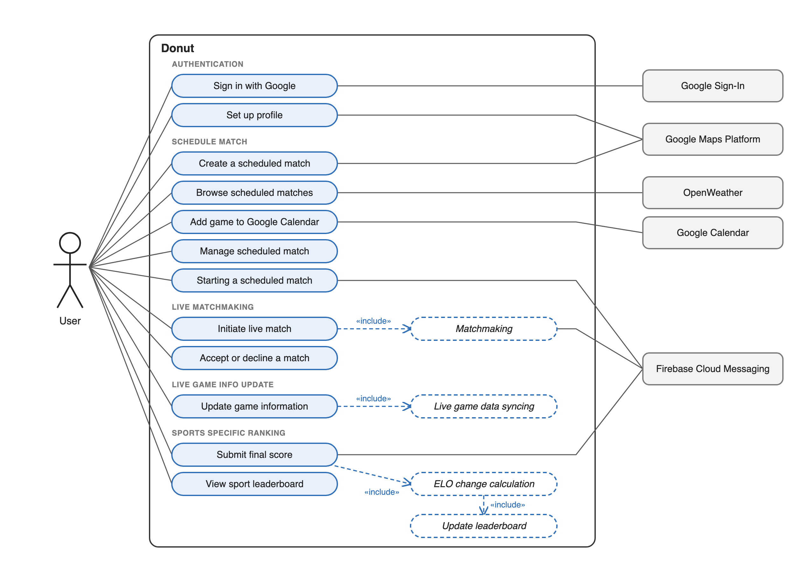
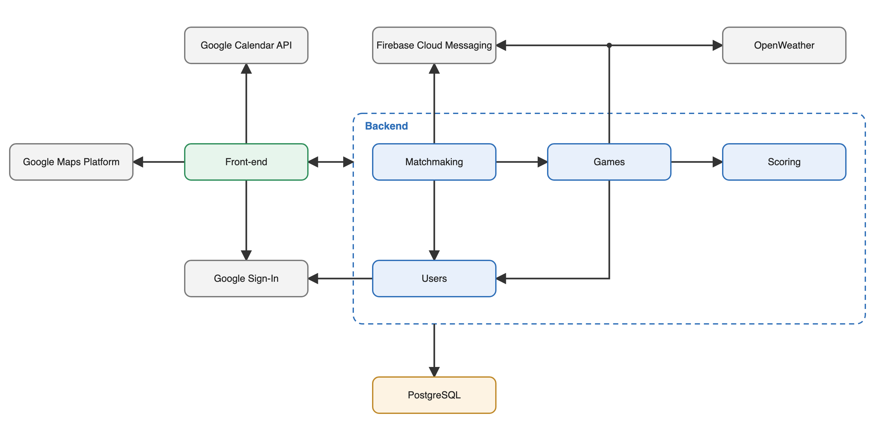
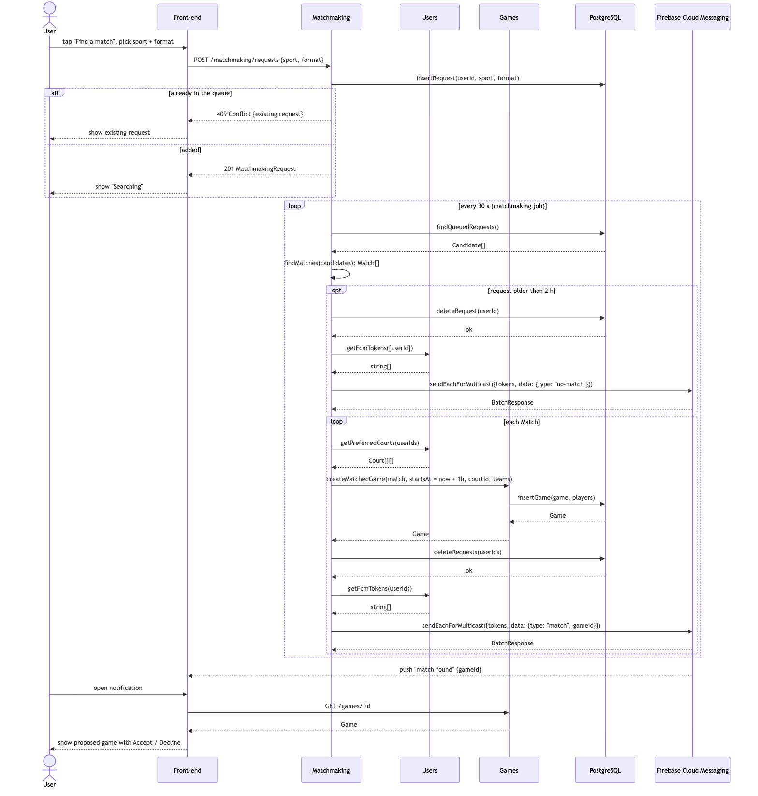
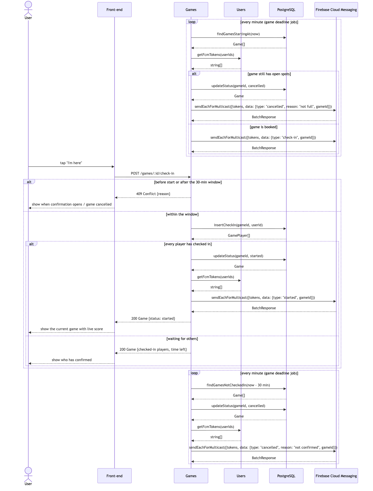
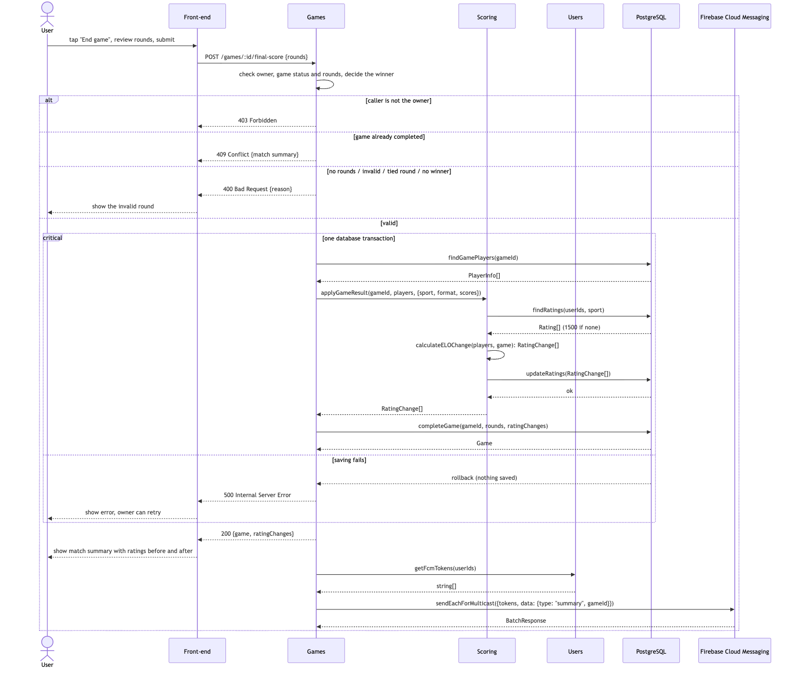
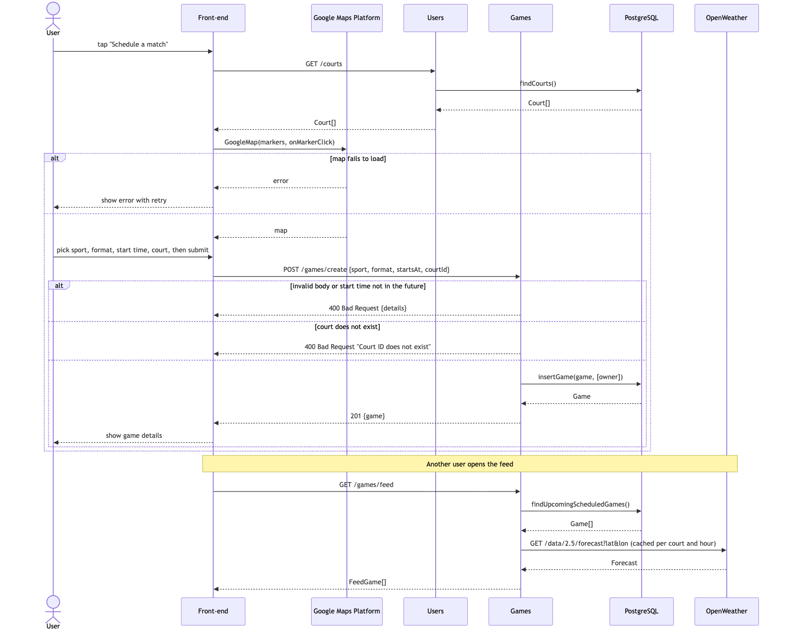
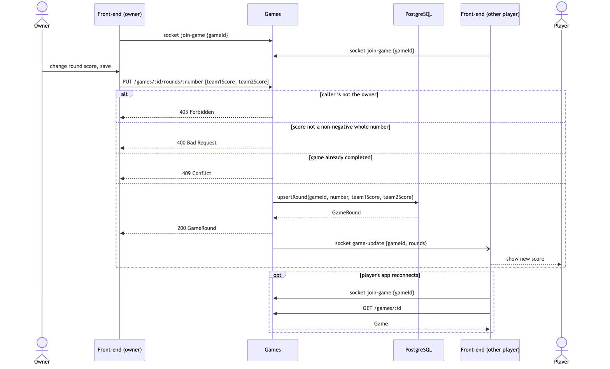

# Requirements and Design

## 1. Change History

| **Change Date**   | **Modified Sections** | **Rationale** |
| ----------------- | --------------------- | ------------- |
| Oct 23, 2026 | 2, 3.1, 3.3, 3.4, 3.5, 4.1, 4.2, 4.7 | Narrowed the first version to tennis only. Pickleball and badminton were dropped, so players no longer pick a sport. |
| Oct 28, 2026 | 4.1 | Added the Games interfaces that change a game's start time and court, and replaced the planned final-score interface with the implemented `POST /games/score`. |
| Nov 1, 2026 | 4.1, 4.3 | Implemented `GET /courts`, `GET /games/feed` (with the OpenWeather forecast) and the new `GET /games/me` that the front-end's Games tab needs, made `GET /games` return the court, players and rounds, and wrote down the join and leave rules (teams, free spots, the 30-minute leave deadline and the `OPEN`/`BOOKED` switch). |
| Nov 1, 2026 | 4.1, 4.2 | `POST /games/score` now updates ratings through the implemented `applyGameResult` and returns each player's rating change. Removed the leftover `sport` parameters from the Games, Matchmaking and Ranking interfaces. |
| Nov 1, 2026 | 4.1, 4.2 | Added the implemented `GET /leaderboard` and `GET /user/me`, and an index for the leaderboard order. |
| Nov 2, 2026 | 3.1, 3.2, 3.4, 4.1, 4.2, 4.3, 4.5 | Added tournaments (8-team single-elimination brackets in singles or doubles): the feature, its use cases, the new Tournaments component and tables, and the Games interface changes that keep tournament games off the feed and out of the join, leave and delete routes. |
| Nov 3, 2026 | 4.1, 4.2 | Documented the implemented Friends component (friend requests and friends list) and its `friendships` table. |
| Nov 3, 2026 | 4.1 | Added `GET /games/history` for the profile's match history, and each player in a `GameDetails` now has `ratingBefore` and `ratingAfter` for the match summary. |

---

## 2. Project Description

Donut is an instant matchmaking and ranking app for people who play competitive tennis (singles and doubles) but can't commit to a weekly league. A player can ask for a game right now and the system finds opponents of similar skill, books a court among the players' preferred courts, and notifies everyone. Players can also schedule a game for later and let others join it from a feed. During a game, the score is updated live on every player's phone, and when the game ends each player's ELO rating changes based on the result and the margin of victory.

The target users are recreational players in a city who want a game this week without joining a league, ladder or club, and who want a fair opponent and a rating that shows how they are improving.

---

## 3. Requirements Specification

### **3.1. List of Features**

#### **Authentication**
Users sign in with their Google account. After the first login, the user sets up their profile by picking their preferred courts on a Google Map; they can edit them later.

#### **Live matchmaking**
Users can start live matchmaking by choosing a format (singles, doubles or either). Our system matches players of a similar rating, books a game one hour later at a court from the players' preferred courts, and notifies everyone. The game is booked once every player accepts.

#### **Schedule match**
Users can schedule a match for a future time, and the open match shows up in the feed, with the weather forecast for that time. Players can join it from the feed and add it to their Google Calendar.

#### **Live game info update**
During an active game, the owner updates the game information (rounds and score), and it syncs to every device that joined the game.

#### **ELO ranking**
An ELO-based ranking that shows a player's skill level compared to others.

#### **Tournaments**
Users can create an 8-team single-elimination tournament in singles or doubles, with a court and a start time, and it shows up in the Games feed while registration is open. Players register one by one. When the last spot fills, our system forms the teams, seeds them by rating, draws the bracket and books the quarterfinals. Reporting a match's score moves the winner on to the next round, and the final crowns the champion.

**Project scope requirements:**
- **External API**: *Schedule match* and *Authentication* use Google Maps to pick courts; *Schedule match* uses OpenWeather and Google Calendar.
- **External event**: *Live matchmaking* and *Live game info update* change the app's state when another player acts (a match notification through Firebase Cloud Messaging, a score update through a live connection).
- **Our own computation**: *Live matchmaking* (the matching algorithm), *ELO ranking* (ELO with margin of victory) and *Tournaments* (the bracket draw, with rating-based seeding and balanced doubles pairing, and moving winners through the bracket).

### **3.2. Use Case Diagram**

External services are connected with plain lines (no arrows) because they support use cases but never start one. The «extend» arrows mark use cases reached from another one: *View Previous Matches* from *View Profile*, and *View/Update Score* and *Leave Match* from *View Upcoming Matches*. The diagram uses screen-level names. *Join Live Matchmaking* covers *Initiate live match* and *Accept or decline a match*, *View/Update Score* covers *Update game information* and *Submit final score*, and *Join Scheduled Match* and *Leave Match* together cover *Manage scheduled match* (§3.4). The steps done by the system (matchmaking, live game data syncing, ELO change calculation and updating the leaderboard) are not drawn because no actor starts them. The tournament use cases (17–20) are not in the diagram yet.

### **3.3. Actors Description**
1. **User**: a recreational tennis player who signs in with Google, joins or accepts games, and enters the score of the games they own. The game owner is a User with extra permissions on that one game, not a separate role.
2. **Google Sign-In** *(external service)*: authenticates players and provides the identity token our backend trusts.
3. **Google Maps Platform** *(external service)*: shows the courts on a map so players can pick preferred courts and the court of a scheduled game.
4. **Firebase Cloud Messaging** *(external service)*: delivers match and game notifications to players' devices.
5. **OpenWeather** *(external service)*: supplies the forecast shown for scheduled games in the feed.
6. **Google Calendar** *(external service)*: stores booked games in the player's own calendar when they ask for it.

### **3.4. Use Case Description**
- Use cases for feature 1: Authentication
1. **Sign in with Google**: User signs in with their Google account, and the server creates their Donut account the first time.
2. **Set up profile**: After the first sign-in, the user picks at least one preferred court on a Google Map. They can change their preferred courts later.

- Use cases for feature 2: Live matchmaking
3. **Initiate live match**: User picks a format and taps a button, and the server places the player into a queue to be matched. The user can cancel at any time, and the request is removed after 2 hours without a match.
4. **Matchmaking**: Every 30 seconds, the system selects players who want a compatible format and have close ratings, books a game one hour later at a court from their preferred courts, then notifies all of them.
5. **Accept or decline a match**: Each notified player accepts or declines. The first player to accept becomes the game's owner. When all accept, the game is booked. If anyone declines, or has not accepted 30 minutes before the start, the match is cancelled for everyone, and the players who did accept go back into the queue.

- Use cases for feature 3: Schedule match
6. **Create a scheduled match**: User creates a scheduled match with format, court (picked on a Google Map) and start time, and becomes its owner.
7. **Browse scheduled matches**: A separate feed that shows all the upcoming scheduled games and relevant game information like other players' ELO rating, format, court information and the weather forecast.
8. **Manage scheduled match**: User can join a scheduled match in the feed, and they can leave the game unless it starts in less than 30 minutes. The owner of the scheduled game can also delete the game at any time.
9. **Add game to Google Calendar**: User adds a booked game to their Google Calendar with its court and start time.
10. **Starting a scheduled match**: User can confirm they are present within 30 minutes after the starting time of the game. A game can only be started if all players confirm they are present within 30 minutes after the starting time, otherwise the game is cancelled automatically. Booked matched games start the same way.

- Use cases for feature 4: Live game info update
11. **Update game information**: The owner of the game can update score and round information using the app.
12. **Live game data syncing**: Live game information like score and rounds is updated across all devices that joined the game.

- Use cases for feature 5: ELO ranking
13. **Submit final score**: The game owner ends the game and submits the final score, and every player sees the match summary with their rating change.
14. **ELO change calculation**: When the final score is submitted, the system calculates each player's ELO change and saves it to the match summary.
15. **Update leaderboard**: The system applies the ELO changes to the leaderboard.
16. **View leaderboard**: User views the leaderboard, which ranks players by their ELO.

- Use cases for feature 6: Tournaments
17. **Create a tournament**: User creates a singles or doubles tournament with a name, court and start time, and is registered as its first player. The tournament shows up in the Games feed, mixed with the scheduled games by start time, until it is full or starts.
18. **Register for or leave a tournament**: User registers for an open tournament from the feed, alone in both formats, until it is full (8 players in singles, 16 in doubles) or starts. A registered player can leave while registration is open. The creator cannot leave, but can cancel the tournament while registration is open, which takes it off the feed.
19. **Bracket draw**: When the last spot fills, the system forms the teams (in doubles, it pairs the strongest player with the weakest, the second strongest with the second weakest, and so on), seeds them by rating, draws the bracket (1 v 8, 4 v 5, 3 v 6, 2 v 7) and books the four quarterfinals at the tournament's court and start time.
20. **View the bracket and play tournament matches**: User views the tournament's bracket with each match's teams, score and winner. A match is played like any booked game, and any of its players submits the final score. The system rates the game and moves the winner on, books the next match once both of its teams are known (the semifinals one hour after the start, the final two hours after), and completes the tournament with its champion after the final.

### **3.5. Formal Use Case Specifications (5 Most Major Use Cases)**

#### Use Case 1: Initiate live match

**Description**: A user asks to be matched for a format. The system puts them in the matchmaking queue, finds players with a close rating, books a court and a start time for them, and notifies everyone.

**Primary actor(s)**: User

**Preconditions**: The user is signed in and has set up their profile, so they have at least one preferred court.

**Postconditions**: A proposed game exists with the format, start time (one hour after the match was found), court and teams set, and every matched player in it. The matched players are no longer in the queue, and each one can accept or decline the game (*Accept or decline a match*).

**Main success scenario**:
1. The user opens the Play tab and taps "Find a match".
2. The system shows a form for format (singles, doubles or either).
3. The user picks a format and submits the form.
4. The system adds the user to the matchmaking queue and shows a "Searching" status.
5. Every 30 seconds, the system looks for enough queued players (2 for singles, 4 for doubles) who want a compatible format ("either" fits both). It takes the longest-waiting player first and groups them with the closest-rated players. The ratings in a group must be within 200 points for singles and 400 points for doubles.
6. The system creates a proposed game that starts one hour from now, at a preferred court all the players share, or else at the court closest to all of their preferred courts. For doubles, it balances the teams: the highest- and lowest-rated players against the middle two. The players are taken out of the queue.
7. The system sends a match notification to every player in the game through Firebase Cloud Messaging.
8. The user opens the notification. The system shows the proposed game (format, court, start time, the other players' ratings) with Accept and Decline buttons.

**Failure scenario(s)**:
- 4a. The user is already in the matchmaking queue.
    - 4a1. The system rejects the new request and shows the existing one.
    - 4a2. The user can cancel the existing request and submit the new one.

- 4b. The server cannot be reached.
    - 4b1. The app shows an error, and the user is not added to the queue.
    - 4b2. The user can retry the submission.

- 5a. No compatible players are in the queue yet.
    - 5a1. The user stays in the queue with the "Searching" status, and the system tries again every 30 seconds.
    - 5a2. If there is still no match after 2 hours, the system removes the request and notifies the user that no match was found. The user can join the queue again.

- 5b. The user cancels the search before a match is found.
    - 5b1. The system removes the user from the queue, and no game is proposed.

- 7a. A player's device cannot receive the notification (it is offline or has no notification token).
    - 7a1. The proposed game stays stored on the server.
    - 7a2. The system shows the proposed game the next time that player opens the app. The acceptance deadline (30 minutes before the start) still applies.

#### Use Case 2: Starting a scheduled match
**Description**: When a booked game reaches its start time, each player confirms they are at the court. If every player confirms within 30 minutes after the start time, the system starts the game. Otherwise, it cancels the game. Booked matched games start the same way.

**Primary actor(s)**: User

**Preconditions**: The user is signed in and is a player in a booked game (every spot filled) that has not started.

**Postconditions**: On success, the game has started and appears as the current game on every player's Play tab, where its owner can update the score. If any player does not confirm in time, the game is cancelled for everyone and no ratings change.

**Main success scenario**:
1. At the game's start time, the system sends every player a notification through Firebase Cloud Messaging, asking them to confirm they are present.
2. The user opens the game from the notification or the Play tab and taps "I'm here".
3. The system records the confirmation. It shows which players have confirmed and how much time is left to confirm.
4. Each of the other players confirms in the same way (steps 2–3).
5. When the last player confirms, the system starts the game and notifies every player that it has started.
6. The system shows the game as the current game on each player's Play tab, with its live score. The game owner can now update the score (*Update game information*).

**Failure scenario(s)**:
- 1a. A scheduled game still has open spots at its start time.
    - 1a1. The system cancels the game.
    - 1a2. The system notifies the players who joined that the game was cancelled because it did not fill.

- 1b. A player's device cannot receive the notification (it is offline or has no notification token).
    - 1b1. The player can still open the game from the Play tab and confirm (step 2).
    - 1b2. The 30-minute confirmation deadline still applies.

- 2a. The user taps "I'm here" before the start time.
    - 2a1. The system does not record the confirmation and shows when confirmation opens.

- 2b. The user tries to confirm after the 30-minute window has ended.
    - 2b1. The system does not record the confirmation and shows that the game was cancelled.

- 3a. The server cannot be reached.
    - 3a1. The app shows an error, and the confirmation is not recorded.
    - 3a2. The user can retry while the confirmation window is still open.

- 4a. A player has not confirmed 30 minutes after the start time.
    - 4a1. The system cancels the game for everyone.
    - 4a2. The system notifies every player that the game was cancelled because not all players confirmed. No ratings change.

- 4b. The game owner deletes the game before every player has confirmed.
    - 4b1. The system cancels the game and notifies every other player that the owner deleted it.

#### Use Case 3: Submit final score
**Description**: When the game owner submits the final score, the system decides the winner and calculates each player's ELO change. It then saves the changes to the match summary and applies them to the leaderboard.

**Primary actor(s)**: User

**Preconditions**: The user is signed in and is a player in a game that has started and has no final score.

**Postconditions**: The game is completed and its final score can no longer be changed. Each player's rating is updated, the match summary shows each player's rating before and after, and the leaderboard reflects the new ratings.

**Main success scenario**:
1. The game owner taps "End game" on the current game in the Play tab.
2. The system shows the rounds recorded during the game as the final score.
3. The owner reviews the final score, corrects any round if needed, and submits it.
4. The system validates the score and decides the winner: the side that won more rounds.
5. The system reads every player's rating. A player with no rating yet starts at 1500.
6. The system calculates the rating change using ELO with margin of victory and the tennis parameters (§7 of the Product Design). In doubles, each team is rated by its players' average rating, and each player receives half of the team's change.
7. The system saves the final score, the new ratings and each player's rating change to the match summary, marks the game as completed, and updates the leaderboard (*Update leaderboard*).
8. The system notifies every player through Firebase Cloud Messaging and shows the match summary with each player's rating before and after the game.

**Failure scenario(s)**:
- 1a. The final score was already submitted.
    - 1a1. The system shows the match summary read-only, and the score cannot be submitted again.

- 1b. The user is not the game owner.
    - 1b1. The Play tab shows the live score without the "End game" button.
    - 1b2. The user sees the match summary once the owner submits the score (step 8).

- 4a. The score has no rounds.
    - 4a1. The system rejects the submission and asks the owner to enter at least one round (step 3).

- 4b. A round score is not a non-negative whole number.
    - 4b1. The system rejects the submission, says which round is invalid, and the owner corrects it (step 3).

- 4c. A round is tied.
    - 4c1. The system rejects the submission, highlights the tied round, and the owner corrects it (step 3).

- 4d. Both sides won the same number of rounds, so there is no winner.
    - 4d1. The system rejects the submission and explains that the match needs a winner. The owner corrects the score (step 3).

- 7a. Saving the score or the ratings fails.
    - 7a1. The system saves nothing: the score, the ratings and the leaderboard are saved together or not at all.
    - 7a2. The app shows an error, and the owner can retry the submission.

- 8a. A player's device cannot receive the notification.
    - 8a1. The system shows the match summary the next time that player opens the app.

#### Use Case 4: Create a scheduled match
**Description**: A user creates a game for a future time by choosing the format, start time and a court on a Google Map. The game appears in the feed so other players can join it.

**Primary actor(s)**: User

**Preconditions**: The user is signed in.

**Postconditions**: An open scheduled game exists with the user as its owner and first player, and it appears in every user's feed until it is full, deleted or started.

**Main success scenario**:
1. The user opens the Play tab and taps "Schedule a match".
2. The system shows a form for format and start date and time, and a Google Map with the courts as markers.
3. The user fills in the format and start time, and taps a court marker.
4. The system shows the selected court's name.
5. The user submits the form.
6. The system validates the game and creates it with the user as owner and first player.
7. The system shows the game's details, and the game appears in the feed for other users with its weather forecast.

**Failure scenario(s)**:
- 2a. The map cannot be loaded (no connection, or Google Maps returns an error).
    - 2a1. The app shows an error with a retry button, and the form cannot be submitted without a court.
    - 2a2. The user retries, and the scenario continues at step 2.

- 6a. The start time is not in the future.
    - 6a1. The system rejects the game and explains that the start time must be in the future.
    - 6a2. The user picks a new start time (step 3).

- 6b. The selected court is not in the system.
    - 6b1. The system rejects the game and asks the user to pick another court (step 3).

- 6c. The server cannot be reached.
    - 6c1. The app shows an error, keeps the form filled in, and the user can retry.

- 7a. The weather forecast cannot be loaded.
    - 7a1. The feed shows the game without a forecast.

#### Use Case 5: Update game information
**Description**: During a started game, the owner enters each round's score. The system saves it and pushes the update to every other player in the game in real time.

**Primary actor(s)**: User

**Preconditions**: The user is signed in and is a player in a game that has started and has no final score.

**Postconditions**: The new score is stored, and every player with the game open sees the same score.

**Main success scenario**:
1. The owner opens the current game in the Play tab.
2. The system shows the rounds so far with score controls, and the app connects to the game's live updates.
3. The owner changes the current round's score, or starts a new round, and saves it.
4. The system validates the score and stores the round.
5. The system sends the update to every player connected to the game.
6. Each other player's app shows the new score without refreshing.

**Failure scenario(s)**:
- 1a. The user is not the game owner.
    - 1a1. The app shows the live score read-only and receives updates (step 6).

- 4a. A score is not a non-negative whole number.
    - 4a1. The system rejects the update, and the owner corrects it (step 3).

- 4b. The game already has a final score.
    - 4b1. The system rejects the update and shows the match summary.

- 4c. The server cannot be reached.
    - 4c1. The app shows an error and keeps the unsaved score on screen.
    - 4c2. The owner can retry when the connection returns.

- 5a. A player's app is not connected (offline or closed).
    - 5a1. When the app reconnects, it rejoins the game's live updates and loads the latest score from the server.

### **3.6. Screen Mock-ups**
Not included. The formal use cases describe each screen in enough detail for this version.

### **3.7. Non-Functional Requirements**

1. **Live score sync latency**
    - **Description**: 95% of score updates are shown on every other connected player's device within 1 second of the owner saving them.
    - **Justification**: Players at the court check the score between points, so a late update makes the app look wrong and people stop trusting it. 1 second is the limit for a user's flow of thought to stay uninterrupted (Nielsen Norman Group). The 95th percentile keeps one slow device from defining the metric.

2. **API response time**
    - **Description**: 95% of REST requests (feed, create, join, accept, score) respond within 500 ms with 50 concurrent users.
    - **Justification**: Players open the app right before playing, often on mobile data, so every screen should load in well under the 1-second flow limit; 500 ms leaves room for the mobile network on top. 50 concurrent users is above the load we expect for the first version in one city.

3. **Match found latency**
    - **Description**: When compatible players are in the matchmaking queue, 95% of them are matched and notified within 60 seconds of the last compatible player joining.
    - **Justification**: Live matchmaking is the core of the app: the players want to play within the hour, and they have only 30 minutes to accept. The matchmaking job runs every 30 seconds, so 60 seconds allows one missed run plus notification delivery.

---

## 4. Designs Specification
### **4.1. Main Components**
1. **Users**
    - **Purpose**: Owns player accounts, Google sign-in, preferred courts, the courts list and device notification tokens.
    - **Rationale**: Everything that answers "who is this player and where do they play" lives in one place. Other components only read it. Alternative considered: putting profile data in the auth flow. Rejected because authentication is delegated to Google and owns no data of its own.
    - **Interfaces**:
        1. `POST /user/login` with `{ idToken: string }` → `{ user: User }` - E
            - **Purpose**: Verifies the Google ID token and returns the player's account, creating it on the first sign-in. Every other request carries the Google ID token in the `Authorization` header and is verified the same way.
        2. `GET /courts` → `{ courts: { id, name, latitude, longitude }[] }` - E
            - **Purpose**: Returns every court with its location, ordered by name, to show as markers on the map.
        3. `PUT /user/me/courts` with `{ courtIds: number[] }` → `Court[]` - E
            - **Purpose**: Replaces the player's preferred courts (profile setup and later edits).
        4. `PUT /user/me/fcm-token` with `{ fcmToken: string }` → `204` - E
            - **Purpose**: Registers the device that receives the player's notifications.
        5. `GET /user/me` → `{ user: User }` - E
            - **Purpose**: Returns the signed-in player's profile, including their rating (full decimal; the app rounds it for display). `404` if the account no longer exists.
        6. `Court[][] getPreferredCourts(userIds: string[])` - In
            - **Purpose**: Used by Matchmaking to choose the court of a matched game.
        7. `string[] getFcmTokens(userIds: string[])` - In
            - **Purpose**: Used by Matchmaking and Games to send notifications.
2. **Games**
    - **Purpose**: Owns games, their players, rounds and lifecycle: create, feed, join, leave, delete, accept, check-in, live score and final score. It also runs the deadline jobs (acceptance and check-in) and the live connection for score updates.
    - **Rationale**: A game is the unit of record: its players, status and rounds change together, so they stay in one component. Alternative considered: a separate live-score component. Rejected because the score is part of the game and would need the same data and the same checks.
    - **Interfaces**:
        1. `POST /games` with `{ format, startsAt, courtId, gameSource }` → `201 { game: Game }` - E
            - **Purpose**: Creates a scheduled game owned by the caller. `gameSource` must be `SCHEDULED` or `MATCHED` (`400` for `TOURNAMENT`, because tournament games are only created by their bracket).
        2. `GET /games/feed` → `{ games: FeedGame[] }` - E
            - **Purpose**: Returns the scheduled games that players can join: `OPEN` (not every spot filled) and not started, soonest first. Only games with `gameSource` `SCHEDULED` are listed, so tournament games never appear. A `FeedGame` is a `GameDetails` (see interface 3) with a `forecast` of `{ at, temperature, description, icon, precipitationChance }` for its court and start time, or `null` if the start time is more than 5 days away or OpenWeather cannot be reached.
        3. `GET /games` with a `gameId` query parameter → `{ game: GameDetails }` - E
            - **Purpose**: Returns one game with its court (`{ id, name, latitude, longitude }`), its players (`{ id, username, name, rating, team, acceptedAt, ratingBefore, ratingAfter }`, by team, where `ratingBefore` and `ratingAfter` are `null` until the final score is reported), its rounds (`{ number, team1Score, team2Score }`, in order) and its `tournament` (`{ id, name, round }`, where round 1 is the quarterfinals, 2 the semifinals and 3 the final, or `null` for a game outside a tournament). `404` if the game does not exist.
        4. `GET /games/me` → `{ games: GameDetails[] }` - E
            - **Purpose**: Returns the caller's upcoming and current games for the Games tab, soonest first: every `BOOKED` game, and every `OPEN` game that has not started (a scheduled game still filling, or a matched game waiting for acceptance). The caller's tournament games are `BOOKED`, so they are included, labelled with their `tournament`.
        5. `GET /games/history` → `{ games: GameDetails[] }` - E
            - **Purpose**: Returns the caller's `COMPLETED` games for the profile's match history, most recent first, each with its final rounds and every player's `ratingBefore` and `ratingAfter`. The app opens a game's match summary from this list.
        6. `DELETE /games` with a `gameId` query parameter → `204` - E
            - **Purpose**: Deletes a game. `404` if the game does not exist, `409` "Tournament games cannot be cancelled" for a tournament game (its bracket depends on it), and `403` if the caller is not in the game.
        7. `POST /games/join` with `{ gameId, team: 1 | 2 }` → `204`, `POST /games/leave` with `{ gameId }` → `204` - E
            - **Purpose**: Join or leave a scheduled game. Joining needs a scheduled game (so not a matched or tournament game) that is `OPEN` and has not started (`409` otherwise) and a free spot on the chosen team (1 per team in singles, 2 in doubles; `409` if the team is full). It is `409` if the caller is already in the game. The game becomes `BOOKED` when its last spot is filled, which takes it off the feed. Leaving is `409` for a tournament game ("Players cannot leave a tournament game"), once the game is completed or cancelled, or less than 30 minutes before the start, and `404` if the caller is not in the game. A `BOOKED` scheduled game goes back to `OPEN` when a player leaves. Both lock the game's row, so two players can't take the last spot at the same time.
        8. `PATCH /games/time` with `{ gameId, startsAt }` → `{ game: Game }` - E
            - **Purpose**: Moves a game to a new start time, which must be in the future. The caller must be in the game, and the game must not be completed or cancelled (`403` and `409` otherwise).
        9. `PATCH /games/location` with `{ gameId, courtId }` → `{ game: Game }` - E
            - **Purpose**: Moves a game to a different court, with the same rules as `PATCH /games/time`. Returns `404` if the court does not exist.
        10. `POST /games/:id/accept` → `Game`, `POST /games/:id/decline` → `204` - E
            - **Purpose**: Accept or decline a matched game.
        11. `POST /games/:id/check-in` → `Game` - E
            - **Purpose**: Confirms the player is at the court; starts the game when every player has confirmed.
        12. `PUT /games/:id/rounds/:number` with `{ team1Score, team2Score }` → `GameRound` - E
            - **Purpose**: The owner saves one round's live score.
        13. Socket.IO `join-game { gameId }` (client → server) and `game-update { gameId, rounds }` (server → client) - E
            - **Purpose**: Pushes each saved round to every player connected to the game.
        14. `POST /games/score` with `{ gameId, rounds: [team1Score, team2Score][] }` → `{ game: Game, rounds: GameRound[], ratingChanges: RatingChange[] }` - E
            - **Purpose**: Ends the game with its final score. The rounds replace any saved during the game, and the game is marked as completed in the same transaction, so the score can only be reported once (`409` after that). Rejected with `400` if there are no rounds, a round score is not a non-negative whole number, a round is tied, or both teams won the same number of rounds. The caller must be in the game, and both teams must be full (`409` otherwise). `applyGameResult` updates every player's rating in the same transaction, so the score and ratings are saved together or not at all, and the response includes each player's rating before and after. For a tournament game, the same transaction also moves the winner on through the bracket (`advanceBracket`, see Tournaments). `409` "The score could not be saved, please try again" if Postgres aborts the transaction as a deadlock (Prisma `P2034`), for example when two games that share a player finish at the same moment; nothing is saved, so the score can be reported again.
        15. `Game createMatchedGame(match: Match, startsAt: Date, courtId: number, teams: string[][])` - In
            - **Purpose**: Used by Matchmaking to create a proposed game.
3. **Matchmaking**
    - **Purpose**: Owns the matchmaking queue and the matching algorithm, run by a background job every 30 seconds.
    - **Rationale**: Matching creates games without any player asking at that moment, so it runs on a timer, outside the request path. Alternative considered: matching inside Games when a request arrives. Rejected because it would put a slow, scheduled job in the request-serving component and make join requests race each other.
    - **Interfaces**:
        1. `POST /matchmaking/requests` with `{ format }` → `201 MatchmakingRequest` - E
            - **Purpose**: Puts the caller in the queue.
        2. `GET /matchmaking/requests/me` → `MatchmakingRequest` - E
            - **Purpose**: Returns the caller's request, to show the "Searching" status.
        3. `DELETE /matchmaking/requests/me` → `204` - E
            - **Purpose**: Takes the caller out of the queue.
        4. `Match[] runMatchmaking()` - In
            - **Purpose**: Called by the matchmaking job: reads the queue, finds matches, creates games and notifies players. It also removes requests older than 2 hours.
4. **Ranking**
    - **Purpose**: Owns ratings, the ELO calculation (with margin of victory and doubles team averages) and the leaderboards.
    - **Rationale**: This is our own computation. It is a pure function that is easy to unit test, and it is the only code allowed to change ratings. Alternative considered: ratings as columns that Games updates directly. Rejected because Matchmaking and the feed also read ratings, and only one component should write them.
    - **Interfaces**:
        1. `RatingChange[] applyGameResult(tx: TransactionClient, gameId: string, format: Format, rounds: RoundScore[])` - In
            - **Purpose**: Called by Games inside the final-score transaction: reads the players' ratings (locking their rows so two games finishing at once can't overwrite each other), calculates the changes, saves each player's new rating and records the rating before and after in the match summary. Throws if either team is not full, which rolls back the whole transaction.
        2. `RatingChange[] calculateELOChange(players: PlayerInfo[], game: GameInfo)` - In
            - **Purpose**: The pure ELO calculation used by `applyGameResult`. Teams are numbered 1 and 2, as everywhere else in the backend.
        3. `Map<string, number> getRatings(userIds: string[])` - In
            - **Purpose**: Used by Games to show players' ratings in the feed and in a proposed game.
        4. `GET /leaderboard` with an optional `limit` query parameter (1–100, default 50) → `{ leaderboard: LeaderboardEntry[], me: LeaderboardEntry }` - E
            - **Purpose**: Returns the top players and the caller's own entry, each with `rank`, `id`, `username`, `name` and `rating`. Ratings are stored and sent with their decimals and the app shows them rounded to whole numbers. Players are ranked by the full decimal rating, so two players who show the same rounded rating are still ordered, and exact ties (such as new players at 1500) are ordered by username.
5. **Tournaments**
    - **Purpose**: Owns tournaments: registration, the bracket draw (forming and seeding the teams), the bracket itself and moving winners through it, up to the champion. Each bracket match is played as an ordinary game (`gameSource` `TOURNAMENT`) owned by Games. Every route requires the signed-in player's `Authorization` header (`401` otherwise), and an invalid body or query is `400` with `details`.
    - **Rationale**: A tournament has its own lifecycle (registration, draw, three rounds, champion) and rules that span several games, so it gets its own component and tables, while each match reuses the game's players, score and ratings. Alternatives considered: reusing the games table for registration (one big open "game" holding the registrants), or modelling each team as a game. Rejected because both would bend the games' team and spot rules, need tournament exceptions in the feed and join code, and leave no place to record who plays whom next; a `tournament_matches` table holds the bracket, and Games only needs to know a game is a tournament game. The bracket writes live in `bracket.repository.ts`, which only takes the caller's transaction and never imports the database client, so Games can call it inside the final-score transaction without an import cycle. Known limitations: only 8-team brackets, no forfeits or walkovers (a no-show stalls the bracket), and no tournament notifications yet.
    - **Interfaces**:
        1. `POST /tournaments` with `{ name, format, startsAt, courtId }` → `201 { tournament: Tournament }` - E
            - **Purpose**: Creates a tournament in `REGISTRATION` and registers the caller, its creator, as its first player in the same write. `name` is trimmed and must be 1–50 characters, `format` is `SINGLES` or `DOUBLES`, and `startsAt` (the quarterfinals' start) is an ISO date-time with an offset, in the future. A `Tournament` is `{ id, name, format, status, startsAt, courtId, creatorId, winningTeam, createdAt }`. `400` for an invalid body, `404` "Court not found" if the court does not exist.
        2. `GET /tournaments/feed` → `{ tournaments: TournamentSummary[] }` - E
            - **Purpose**: Returns the tournaments that players can register for: `REGISTRATION` and not started, soonest first. A `TournamentSummary` is a `Tournament` with `capacity` (8 players in singles, 16 in doubles), `court` (`{ id, name, latitude, longitude }`), `creator` (`{ id, username, name, rating }`) and `players` (`{ id, username, name, rating, team, joinedAt }`, in registration order), where `team` is the player's team's seed (1 is the top seed), or `null` before the draw, and `winningTeam` is the champion's seed, or `null` until the final. On the feed each one also has a `forecast` like a `FeedGame`'s, or `null`. The app mixes them into the Games feed by start time. A tournament that has not filled by its start time drops off the feed then, with no background job.
        3. `GET /tournaments/me` → `{ tournaments: TournamentSummary[] }` - E
            - **Purpose**: Returns the tournaments the caller is registered for, soonest first: every `IN_PROGRESS` one, every `REGISTRATION` one that has not started, and every `COMPLETED` one that started within the last 24 hours, so the champion stays visible that day. No forecast.
        4. `GET /tournaments` with a `tournamentId` query parameter → `{ tournament: TournamentDetails }` - E
            - **Purpose**: Returns one tournament with its bracket. A `TournamentDetails` is a `TournamentSummary` (without a forecast) with `matches` (`{ round, position, team1, team2, winner, game }`, ordered by round and position): round 1 is the quarterfinals (positions 0–3), 2 the semifinals (0–1) and 3 the final (0). `team1`, `team2` and `winner` are seeds, or `null` until known, and `game` is `{ id, status, startsAt, court, rounds }`, or `null` until both teams are known. `matches` is empty before the draw. `400` if the ID is not a UUID, `404` "Tournament not found".
        5. `POST /tournaments/join` with `{ tournamentId }` → `204` - E
            - **Purpose**: Registers the caller, alone in both formats. `404` "Tournament not found"; `409` "Tournament is not open for registration" (cancelled, completed or started), "Tournament is full" (also once the bracket is drawn) or "User already registered"; `404` "User not found" if the caller's account no longer exists. The registration that fills the tournament draws the bracket (`drawBracket`) in the same transaction. It locks the tournament's row, so two players can't take the last spot at the same time.
        6. `POST /tournaments/leave` with `{ tournamentId }` → `204` - E
            - **Purpose**: Takes the caller out of a tournament that is still in registration. `404` "Tournament not found" or "User not registered"; `409` "Tournament is not open for registration" or "The creator cannot leave the tournament, cancel it instead". It holds the same lock, so a player can't leave while the last registration draws the bracket.
        7. `DELETE /tournaments` with a `tournamentId` query parameter → `204` - E
            - **Purpose**: The creator cancels a tournament that is still in registration, including one that did not fill by its start time. The tournament is kept with status `CANCELLED`, so it leaves the feed and nobody can join it. `404` "Tournament not found", `403` "Only the creator can cancel the tournament", `409` "Tournament is not open for registration".
        8. `void drawBracket(tx: TransactionClient, tournament: { id, format, courtId, startsAt }, now: Date)` - In
            - **Purpose**: Called by Tournaments in the transaction of the registration that fills the tournament, while it holds the tournament's lock: forms and seeds the teams with `formTeams`, saves each player's seed and the bracket's 7 matches, books the 4 quarterfinal games (`BOOKED`, `gameSource` `TOURNAMENT`, every player already accepted) at the tournament's court and start time, and marks the tournament `IN_PROGRESS`. Throws if the players do not fill the bracket, which rolls back the registration.
        9. `void advanceBracket(tx: TransactionClient, gameId: string, rounds: RoundScore[], now: Date)` - In
            - **Purpose**: Called by Games inside the final-score transaction of a tournament game: records the match's winner and puts them into their next match. Once both teams of that match are known, it books its game at the start time plus 1 hour for a semifinal or plus 2 hours for the final, or now if that time has passed. After the final, it marks the tournament `COMPLETED` and sets `winningTeam` to the champion's seed. It locks the tournament's row first, so when both feeder matches are reported at once the second one sees the first one's winner and exactly one next-round game is booked. Does nothing for a game outside a bracket or a match that is already decided.
        10. `string[][] formTeams(entrants: Entrant[], format: Format)` - In
            - **Purpose**: The pure team draw used by `drawBracket`. Ranks the entrants by rating (the earlier registration, then the user ID, break ties). In singles each player is a team; in doubles it pairs the strongest player with the weakest, the second strongest with the second weakest, and so on, so the teams are balanced. Teams are seeded by average rating, top seed first. The quarterfinals are 1 v 8, 4 v 5, 3 v 6 and 2 v 7, so the top two seeds can only meet in the final. Throws if the entrants do not fill the bracket exactly.
6. **Friends**
    - **Purpose**: Owns friendships between players: sending, accepting and removing friend requests, and listing friends. Every route requires the signed-in player's `Authorization` header (`401` otherwise), and an invalid body or query is `400` with `details`.
    - **Rationale**: Friendships only link two users and touch no game, rating or tournament data, so they get their own small component. One `friendships` row per pair, holding who sent the request and whether it was accepted, covers requests and friends without a second table. Alternative considered: separate request and friend tables. Rejected because accepting would move a row between tables, and keeping the pair unique across both would need extra checks.
    - **Interfaces**:
        1. `GET /friends` → `{ friends: Friend[] }` - E
            - **Purpose**: Returns the caller's accepted friends, most recent first. A `Friend` is `{ id, username, name, rating, friendsSince }`.
        2. `GET /friends/requests` → `{ incoming: FriendRequest[], outgoing: FriendRequest[] }` - E
            - **Purpose**: Returns the pending requests the caller received and sent, most recent first. A `FriendRequest` is `{ id, username, name, rating, requestedAt }`, where the user is the other player.
        3. `POST /friends/requests` with `{ userId }` → `201 { status: "PENDING" | "ACCEPTED" }` - E
            - **Purpose**: Sends a friend request (`PENDING`). If the other player already sent one to the caller, it accepts theirs instead (`ACCEPTED`). The app's match summary uses it for its "Add friend" button. `400` "Cannot friend yourself", `409` "Already friends" or "Request already sent", `404` "User not found".
        4. `POST /friends/requests/accept` with `{ userId }` → `204` - E
            - **Purpose**: Accepts the pending request that `userId` sent to the caller. `404` "Friend request not found".
        5. `DELETE /friends` with a `userId` query parameter → `204` - E
            - **Purpose**: Removes a friend, or declines or cancels a pending request, in either direction. `404` "Friendship not found".

### **4.2. Databases**
1. **PostgreSQL (`donut`)**
    - **Purpose**: Stores users, ratings, courts, preferred courts, the matchmaking queue, games, game players (with each player's rating before and after a completed game), rounds and tournaments (`backend/prisma/schema.prisma`). A game's `gameSource` is `SCHEDULED`, `MATCHED` or `TOURNAMENT`. `tournaments` holds each tournament's name, format, status (`REGISTRATION`, `IN_PROGRESS`, `COMPLETED` or `CANCELLED`), court, start time, creator and the champion's seed, indexed by status and start time for the feed. `tournament_players` holds the registered players, each with their team's seed once the bracket is drawn. `tournament_matches` holds the bracket's 7 matches by round and position, with the seeds playing, the winner and the match's game once it is booked. `friendships` holds one row per pair of players, keyed by requester and addressee, with its status (`PENDING` or `ACCEPTED`).
    - **Rationale**: The data is relational: a match joins the queue with ratings and courts, and a game joins players and rounds. One relational database keeps those joins in single queries and lets a match or a final score (with the ratings and, for a tournament game, the bracket) be saved in one transaction. Alternative considered: MongoDB. Rejected because nothing here is document-shaped, and we would lose transactions across collections.

### **4.3. External Modules**
1. **Google Sign-In**
    - **Purpose**: Signs players in on Android and issues the ID token the backend verifies.
    - **Rationale**: The course requires external authentication, and storing passwords ourselves would be less secure for no benefit.
    - **Interfaces we call**:
        1. `LoginTicket verifyIdToken({ idToken: string, audience: string })` (google-auth-library) - called by Users
            - **Purpose**: Checks the ID token's signature and audience and returns the player's Google profile.
        2. `GoogleIdTokenCredential getCredential(GetGoogleIdOption)` (Credential Manager) - called by the front-end
            - **Purpose**: Signs the player in on the device and returns the ID token sent to `POST /user/login`.
2. **Google Maps Platform (Maps SDK for Android)**
    - **Purpose**: Shows the courts as markers so players can pick preferred courts and the court of a scheduled game.
    - **Rationale**: Players recognise courts by where they are, not by name. The courts themselves are stored in our database, so the map is only used for display and picking.
    - **Interfaces we call**:
        1. `GoogleMap(markers: Marker[], onMarkerClick)` (Maps Compose) - called by the front-end
            - **Purpose**: Shows the courts as markers and reports which one the player picks.
3. **Firebase Cloud Messaging**
    - **Purpose**: Delivers match, game start, cancellation and match summary notifications, even when the app is closed.
    - **Rationale**: It is the standard push service for Android and needs no polling.
    - **Interfaces we call**:
        1. `BatchResponse sendEachForMulticast({ tokens: string[], data: Map<string, string> })` (firebase-admin) - called by Games and Matchmaking
            - **Purpose**: Sends one notification to every device of the players in a game.
4. **OpenWeather**
    - **Purpose**: Supplies the forecast for a scheduled game's or open tournament's court and time, shown in the feed.
    - **Rationale**: Most courts are outdoors, so the weather decides whether a game happens. Free tier is enough for our load.
    - **Interfaces we call**:
        1. `GET /data/2.5/forecast?lat={lat}&lon={lon}&units=metric&appid={key}` → `Forecast` (3-hour steps for 5 days) - called by Games and Tournaments
            - **Purpose**: Gets the forecast at the court; the step closest to the game's or tournament's start time (within 1.5 hours) is picked. Each court's forecast is cached for 10 minutes, so a feed request makes at most one call per court. A request times out after 2 seconds. The API key comes from `OPENWEATHER_API_KEY`; without it, or when a call fails, the feed shows games without a forecast.
5. **Google Calendar API**
    - **Purpose**: Adds a booked game to the player's own Google Calendar.
    - **Rationale**: Players already use Google accounts to sign in, so they can add the game to their own calendar without a separate account.
    - **Interfaces we call**:
        1. `POST /calendars/primary/events` with `{ summary, location, start, end }` → `Event` - called by the front-end
            - **Purpose**: Adds the booked game to the player's own calendar.

### **4.4. Frameworks and Libraries**
Libraries marked *(planned)* are part of the design but not in the code yet.

1. **Express 5**
    - **Purpose**: HTTP server and routing for the REST API.
    - **Reason**: Minimal and widely used for Node.js. Its routes → controllers → services → repositories structure matches the course's reference architecture.
2. **Prisma 7 (with `@prisma/adapter-pg`) and PostgreSQL 17**
    - **Purpose**: Database schema, migrations and typed queries.
    - **Reason**: Queries are type-checked against the schema, and migrations make the database reproducible on any machine.
3. **TypeScript 5.9 and tsx**
    - **Purpose**: Backend language and development runner.
    - **Reason**: Catches interface mismatches between components at compile time.
4. **node-cron**
    - **Purpose**: Runs the matchmaking job every 30 seconds and the deadline jobs.
    - **Reason**: Small, in-process scheduler with a no-overlap option, so one run never starts while the last is still going.
5. **google-auth-library**
    - **Purpose**: Verifies Google ID tokens on the backend.
    - **Reason**: Google's official library; it checks the token signature and audience for us.
6. **zod** *(planned)*
    - **Purpose**: Validates request bodies.
    - **Reason**: One schema gives both the runtime check and the TypeScript type.
7. **Socket.IO** (server and Android client) *(planned)*
    - **Purpose**: Live score updates in a room per game.
    - **Reason**: Keeps one connection open per player, so updates arrive without polling. It reconnects automatically and supports rooms out of the box.
8. **firebase-admin** *(planned)*
    - **Purpose**: Sends Firebase Cloud Messaging notifications from the backend.
    - **Reason**: Google's official server SDK for FCM.
9. **Jest 30, ts-jest and Supertest**
    - **Purpose**: Backend unit, integration and non-functional tests.
    - **Reason**: Required by the course's testing setup. Supertest calls the Express app directly without starting a server.
10. **Kotlin 2.1 and Jetpack Compose (Material 3)**
    - **Purpose**: The Android app and its UI.
    - **Reason**: The course template's pinned toolchain, which builds on the TAs' machines.
11. **Retrofit and OkHttp** *(planned)*
    - **Purpose**: HTTP client for the backend API.
    - **Reason**: The standard typed REST client on Android.
12. **Credential Manager (Sign in with Google)** *(planned)*
    - **Purpose**: Google sign-in on Android.
    - **Reason**: Google's current recommended sign-in API on Android.
13. **Maps Compose** *(planned)*
    - **Purpose**: Google Maps inside Compose screens.
    - **Reason**: Google's official Compose wrapper for the Maps SDK.
14. **Firebase Messaging (Android)** *(planned)*
    - **Purpose**: Receives push notifications on the device.
    - **Reason**: The client side of FCM.

### **4.5. Dependencies Diagram**

An arrow from A to B means A calls B through at least one interface defined in B (§4.1, §4.3). Arrows that touch the Backend box apply to all four backend components: the front-end calls every one of them, and every one of them reads and writes PostgreSQL. The front-end arrow points both ways because Games also calls the front-end's `game-update` Socket.IO handler to push live scores. The Tournaments component is not drawn yet: the front-end calls it, it reads and writes PostgreSQL, it calls OpenWeather for the feed's forecasts, and Games calls it (`advanceBracket`) when a tournament game's score is reported.

### **4.6. Use Case Sequence Diagram (5 Most Major Use Cases)**
1. [**Initiate live match**](#uc1)

2. [**Starting a scheduled match**](#uc2)

3. [**Submit final score**](#uc3)

4. [**Create a scheduled match**](#uc4)

5. [**Update game information**](#uc5)

### **4.7. Design of Non-Functional Requirements**
1. [**Live score sync latency**](#nfr1)
    - **Implementation**: Every player with a game open joins that game's Socket.IO room. When the owner saves a round, Games writes it to the database and immediately emits `game-update` to the room over connections that are already open, so there is no polling and no new connection per update. An app that reconnects loads the latest score with `GET /games/:id`.
2. [**API response time**](#nfr2)
    - **Implementation**: The columns we filter on most (user, court, game) are indexed. The feed loads games, players and ratings in one query instead of one per game. Forecasts are cached per court and hour, so the feed rarely waits on OpenWeather. Matchmaking runs in a background job, outside the request path.
3. [**Match found latency**](#nfr3)
    - **Implementation**: The matchmaking job runs every 30 seconds with no overlap between runs. The greedy matcher sorts each format queue once, so a run takes milliseconds for our expected queue sizes. Each match is saved in its own transaction, and the notifications are sent right after it commits.
