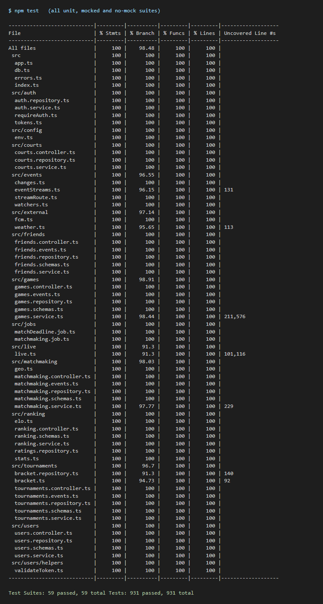
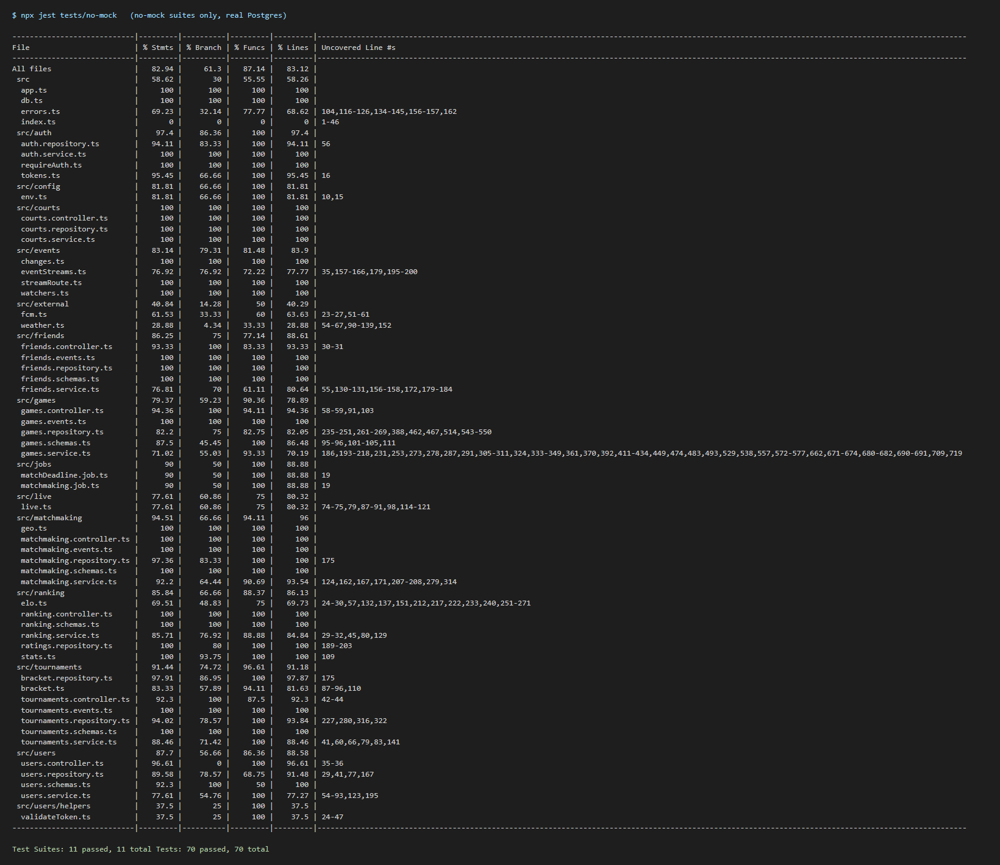

# Testing

## 1. Change History

| **Change Date**   | **Modified Sections** | **Rationale** |
| ----------------- | --------------------- | ------------- |
| 10-19-2026        | 2. Back-end Test      | Added tests   |
| 11-01-2026        | 2.1.1                 | Added tests for `GET /courts`, `GET /games`, `GET /games/feed`, `GET /games/me`, `POST /games/join` and `POST /games/leave`, the OpenWeather client and the games and courts repositories |
| 11-02-2026        | 2.1.1, 2.1.3, 2.2     | Added tests for the tournament routes, the tournament and bracket repositories and the bracket rules, updated the rows of the games routes that tournaments changed, and noted that the no-mock tests need a migrated Postgres database |
| 11-03-2026        | 2.1.1                 | Added tests for `GET /games/history`, and listed the existing tests of the friends routes |
| 11-03-2026        | 2.1.1                 | Added tests for `POST /games/invite`, and for `deleteGame` removing a game's players, rounds and equipment |
| 11-03-2026        | 2.1, 3, 4             | Listed the existing tests of the user, matchmaking, accept and leaderboard routes, the deadline job and `requireAuth`; set the commit and clone URL; replaced the template examples in 3 and 4 with what exists |
| 11-03-2026        | 4.2                   | Added the end-to-end test of Use Case 4 (create a scheduled match), with its steps and log |
| 11-18-2026        | 2.1.1                 | Updated the ELO unit tests (`elo.test.ts`) and `ranking.service.test.ts` for the K-factor that depends on games played, and added tests of `calculateKFactor` |
| 11-18-2026        | 2.1.1                 | Added tests for `GET /stats` (mocked, no-mock and the `stats.test.ts` unit tests) and for the games-played count in `fetchGamePlayerRatingsForUpdate` |
| 11-18-2026        | 2.1.1                 | Added tests for `POST /games/start` (mocked, `startBookedGame`, and starting a quarterfinal early in the no-mock tournament flow) |
| 11-20-2026        | 2.1.1                 | Added the no-mock matchmaking flow (`tests/no-mock/matchmaking.test.ts`): a run takes both players out of the queue, puts the match in both players' games and on the live Games stream, keeps them from queueing again, and books it once both accept. Added tests for `GET /matchmaking/events` (mocked, `refreshEach`, the queue changes `runMatchmaking` announces, and the queue stream in the no-mock flow) |
| 11-20-2026        | 2.1.1                 | Score confirmation: added tests for `POST /games/score/confirm` and `recordScore`, and changed the `POST /games/score` tests so a game completes only once every player confirms (the no-mock flows now confirm as the other player, and test a correction and a stale confirmation) |
| 11-20-2026        | 2.1.1                 | Set score rule: added tests that past 6 games a set is won by 2 games or 7–6 on both score routes, that 99–97 rates like 8–6 (`elo.test.ts`), and that an unaccepted matched game can't be scored |
| 11-20-2026        | 2.1, 2.3, 2.4         | Added no-mock tests for every interface that had none: the user, friends, courts, leaderboard and game routes, the queue, and both scheduled jobs. Every no-mock test now creates its own users and data, so the tests no longer depend on the order they run in. Split `tests/mock/games.test.ts` (3,200 lines) into five files by area. Added the coverage screenshots, with a justification for every file under 100%, and set the commit and the links |
| 11-20-2026        | 3                     | Added the tests of the non-functional requirements in `backend/tests/nfr/`: API response time, match found latency, and the new rating accuracy requirement (Requirements_and_Design.md 3.7), with their logs |
| 11-20-2026        | 2.1.1, 3.1            | Listed the live update streams and named Matchmaking as the fully tested component. Renumbered the NFRs to match Requirements_and_Design.md and removed the live score NFR. |
| 11-20-2026        | 4.2.1                 | Added the failure scenarios of Use Case 4 to the end-to-end test, and `CreateGameViewModelTest` for the ones the UI can't cause. |
| 11-20-2026        | 2.1.1                 | Added no-mock tests for the live update streams (`tests/no-mock/liveUpdates.test.ts`). |

---

## 2. Back-end Test Specification: APIs

### 2.1. Locations of Back-end Tests and Instructions to Run Them

#### 2.1.1. Tests

| **Interface**                 | **Describe Group Location, No Mocks**                | **Describe Group Location, With Mocks**            | **Mocked Components**              |
| ----------------------------- | ---------------------------------------------------- | -------------------------------------------------- | ---------------------------------- |
| **POST /user/login**          | [`tests/no-mock/users.test.ts`] *(rejections only, see below)* | [`tests/mock/userLogin.test.ts`], [`tests/mock/validateToken.test.ts`], [`tests/mock/users.repository.test.ts`] | Google Authentication API, User DB |
| **POST /user/refresh**        | [`tests/no-mock/users.test.ts`]                      | [`tests/mock/userRefresh.test.ts`], [`tests/mock/users.repository.test.ts`] | Refresh token DB                   |
| **POST /user/logout**         | [`tests/no-mock/users.test.ts`]                      | [`tests/mock/userLogout.test.ts`]                  | Refresh token DB                   |
| **GET /user/me**              | [`tests/no-mock/users.test.ts`]                      | [`tests/mock/userMe.test.ts`]                      | User DB                            |
| **PUT /user/me/fcm-token**    | [`tests/no-mock/users.test.ts`]                      | [`tests/mock/userFcmToken.test.ts`]                | User DB                            |
| **GET /user/:userId/photo**   | [`tests/no-mock/users.test.ts`]                      | [`tests/mock/userPhoto.test.ts`]                   | User DB                            |
| **PUT, GET, DELETE /user/me/preferred-courts** | [`tests/no-mock/users.test.ts`]     | [`tests/mock/userPreferredCourts.test.ts`]         | User DB, Court DB                  |
| **GET, POST /user/equipment**, **PATCH, DELETE /user/equipment/:equipmentId** | [`tests/no-mock/users.test.ts`] | [`tests/mock/userEquipment.test.ts`], [`tests/mock/users.repository.test.ts`] | Equipment DB |
| **POST, GET, DELETE /matchmaking**, **GET /matchmaking/nearby** | [`tests/no-mock/matchmaking.test.ts`], [`tests/no-mock/queue.test.ts`] | [`tests/mock/matchmaking.test.ts`] | Matchmaking DB |
| **GET /matchmaking/events**   | [`tests/no-mock/matchmaking.test.ts`]                | [`tests/mock/queueEvents.test.ts`], [`tests/unit/eventStreams.test.ts`], [`tests/unit/matchmaking.service.test.ts`] | Matchmaking DB |
| **Matchmaking job**           | [`tests/no-mock/matchmaking.test.ts`], [`tests/no-mock/queue.test.ts`] | [`tests/mock/matchmaking.job.test.ts`], [`tests/unit/matchmaking.service.test.ts`] | Task Scheduler, Matchmaking DB |
| **Match deadline job**        | [`tests/no-mock/jobs.test.ts`]                       | [`tests/mock/matchDeadline.job.test.ts`]           | Task Scheduler                     |
| **GET /leaderboard**          | [`tests/no-mock/courtsLeaderboard.test.ts`]          | [`tests/mock/leaderboard.test.ts`]                 | User DB                            |
| **GET /stats**                | [`tests/no-mock/playerStats.test.ts`]                | [`tests/mock/stats.test.ts`], [`tests/mock/ratings.repository.test.ts`] | User DB, Game DB         |
| **GET /courts**               | [`tests/no-mock/courtsLeaderboard.test.ts`]          | [`tests/mock/courts.test.ts`], [`tests/mock/repositories.test.ts`] | Court DB                 |
| **POST /games**               | [`tests/no-mock/games.test.ts`]                      | [`tests/mock/games.read.test.ts`], [`tests/mock/repositories.test.ts`] | Game DB                    |
| **GET /games**                | [`tests/no-mock/games.test.ts`], [`tests/no-mock/playerStats.test.ts`] | [`tests/mock/games.read.test.ts`], [`tests/mock/repositories.test.ts`] | Game DB |
| **GET /games/feed**           | [`tests/no-mock/tournaments.test.ts`]                | [`tests/mock/games.read.test.ts`], [`tests/mock/repositories.test.ts`], [`tests/mock/weather.test.ts`] | Game DB, OpenWeather API |
| **GET /games/me**             | [`tests/no-mock/tournaments.test.ts`], [`tests/no-mock/matchmaking.test.ts`] | [`tests/mock/games.read.test.ts`], [`tests/mock/repositories.test.ts`] | Game DB |
| **GET /games/history**        | [`tests/no-mock/games.test.ts`]                      | [`tests/mock/games.read.test.ts`], [`tests/mock/repositories.test.ts`] | Game DB                    |
| **DELETE /games**             | [`tests/no-mock/tournaments.test.ts`]                | [`tests/mock/games.membership.test.ts`], [`tests/mock/games.matched.test.ts`], [`tests/mock/repositories.test.ts`] | Game DB, Firebase Cloud Messaging |
| **POST /games/join**          | [`tests/no-mock/tournaments.test.ts`], [`tests/no-mock/games.test.ts`] | [`tests/mock/games.membership.test.ts`], [`tests/mock/repositories.test.ts`] | Game DB |
| **POST /games/leave**         | [`tests/no-mock/tournaments.test.ts`]                | [`tests/mock/games.membership.test.ts`], [`tests/mock/repositories.test.ts`] | Game DB              |
| **POST /games/accept**        | [`tests/no-mock/games.test.ts`], [`tests/no-mock/matchmaking.test.ts`] | [`tests/mock/games.matched.test.ts`], [`tests/mock/repositories.test.ts`] | Game DB, Firebase Cloud Messaging |
| **POST /games/invite**        | [`tests/no-mock/games.test.ts`]                      | [`tests/mock/games.matched.test.ts`]               | Game DB, Friendship DB, User DB, Firebase Cloud Messaging |
| **PATCH /games/time**         | [`tests/no-mock/games.test.ts`]                      | [`tests/mock/games.edit.test.ts`]                  | Game DB                            |
| **PATCH /games/location**     | [`tests/no-mock/games.test.ts`]                      | [`tests/mock/games.edit.test.ts`]                  | Game DB                            |
| **POST /games/start**         | [`tests/no-mock/tournaments.test.ts`], [`tests/no-mock/games.test.ts`] | [`tests/mock/games.edit.test.ts`], [`tests/mock/repositories.test.ts`] | Game DB |
| **POST /games/score**         | [`tests/no-mock/tournaments.test.ts`], [`tests/no-mock/playerStats.test.ts`], [`tests/no-mock/games.test.ts`] | [`tests/mock/games.score.test.ts`], [`tests/mock/repositories.test.ts`], [`tests/mock/bracket.repository.test.ts`] | Game DB, Tournament DB, Firebase Cloud Messaging |
| **POST /games/score/confirm** | [`tests/no-mock/tournaments.test.ts`], [`tests/no-mock/playerStats.test.ts`], [`tests/no-mock/games.test.ts`] | [`tests/mock/games.score.test.ts`], [`tests/mock/repositories.test.ts`] | Game DB, Tournament DB |
| **GET /games/events**, **GET /games/feed/events** | [`tests/no-mock/liveUpdates.test.ts`], [`tests/no-mock/matchmaking.test.ts`] | [`tests/mock/gameEvents.test.ts`], [`tests/mock/liveLists.test.ts`], [`tests/mock/live.test.ts`] | Game DB |
| **POST /tournaments**         | [`tests/no-mock/tournaments.test.ts`]                | [`tests/mock/tournaments.test.ts`], [`tests/mock/tournaments.repository.test.ts`] | Tournament DB                      |
| **GET /tournaments**          | [`tests/no-mock/tournaments.test.ts`]                | [`tests/mock/tournaments.test.ts`], [`tests/mock/tournaments.repository.test.ts`] | Tournament DB                      |
| **GET /tournaments/feed**     | [`tests/no-mock/tournaments.test.ts`]                | [`tests/mock/tournaments.test.ts`], [`tests/mock/tournaments.repository.test.ts`], [`tests/mock/weather.test.ts`] | Tournament DB, OpenWeather API     |
| **GET /tournaments/me**       | [`tests/no-mock/tournaments.test.ts`]                | [`tests/mock/tournaments.test.ts`], [`tests/mock/tournaments.repository.test.ts`] | Tournament DB                      |
| **POST /tournaments/join**    | [`tests/no-mock/tournaments.test.ts`]                | [`tests/mock/tournaments.test.ts`], [`tests/mock/tournaments.repository.test.ts`], [`tests/mock/bracket.repository.test.ts`] | Tournament DB, Game DB             |
| **POST /tournaments/leave**   | [`tests/no-mock/tournaments.test.ts`]                | [`tests/mock/tournaments.test.ts`], [`tests/mock/tournaments.repository.test.ts`] | Tournament DB                      |
| **DELETE /tournaments**       | [`tests/no-mock/tournaments.test.ts`]                | [`tests/mock/tournaments.test.ts`], [`tests/mock/tournaments.repository.test.ts`] | Tournament DB                      |
| **GET /tournaments/events** | [`tests/no-mock/liveUpdates.test.ts`] | [`tests/mock/liveLists.test.ts`] | Tournament DB |
| **GET /friends**              | [`tests/no-mock/friends.test.ts`]                    | [`tests/mock/friends.test.ts`]                     | Friendship DB                      |
| **GET /friends/requests**     | [`tests/no-mock/friends.test.ts`]                    | [`tests/mock/friends.test.ts`]                     | Friendship DB                      |
| **POST /friends/requests**    | [`tests/no-mock/friends.test.ts`]                    | [`tests/mock/friends.test.ts`]                     | Friendship DB                      |
| **POST /friends/requests/accept** | [`tests/no-mock/friends.test.ts`]                | [`tests/mock/friends.test.ts`]                     | Friendship DB                      |
| **DELETE /friends**           | [`tests/no-mock/friends.test.ts`]                    | [`tests/mock/friends.test.ts`]                     | Friendship DB                      |
| **GET /friends/events** | [`tests/no-mock/liveUpdates.test.ts`] | [`tests/mock/friendEvents.test.ts`], [`tests/mock/live.test.ts`] | Friendship DB |

**Matchmaking** is the component with every interface tested both with and without mocks, including its live stream (`GET /matchmaking/events`) and both jobs.

Every no-mock test runs against a real, migrated Postgres database (see 2.1.3). Each test creates its own users (with [`tests/realDb.ts`]) and builds the data it needs through the API, then deletes it, so the tests don't depend on each other or on the order they run in (they pass with `npx jest tests/no-mock --randomize`). The flow files do this with stage helpers: in `tournaments.test.ts` each test creates a tournament and drives it to the stage it checks (`createTournament`, `fillTournament`, `playQuarterfinals`), and in `playerStats.test.ts` each test plays the games it needs first (`playFirstGame`, `playSecondGame`). A matchmaking run matches everyone queued, and its live pushes only reach streams in its own Jest worker, so every no-mock test that runs matchmaking is in `matchmaking.test.ts`, where they run one at a time.

`POST /user/login` can only succeed with an ID token Google signed for this app, so its no-mock test checks that a token that can't be verified and a missing token are rejected; the sign-in itself is tested with Google mocked. `queue.test.ts` also checks that `claimMatch` puts players back in the queue and `saveRatingChanges` rolls every rating back when the database refuses a write. [`tests/no-mock/requireAuth.test.ts`] checks the `Authorization` header that every route except login, refresh and logout requires, and [`tests/no-mock/health.test.ts`] checks `GET /health` and unknown routes. The server's entry point (start-up and shutdown) is tested in [`tests/mock/index.test.ts`], and the environment settings in [`tests/unit/env.test.ts`]. Pure logic is unit tested in `tests/unit/`: the bracket rules ([`tests/unit/bracket.test.ts`]), ELO and its K-factor ([`tests/unit/elo.test.ts`]), player stats ([`tests/unit/stats.test.ts`]), distances ([`tests/unit/geo.test.ts`]), matching ([`tests/unit/matchmaking.service.test.ts`]) and tokens ([`tests/unit/tokens.test.ts`]). The mocked `/games` tests share their games and players through [`tests/mock/gamesFixtures.ts`].

#### 2.1.2. Commit Hash Where Tests Run

[`bfb755e442097a5c7e4fdfa2230cc42d006174a8`](https://github.com/donut-cpen321/donut/commit/bfb755e442097a5c7e4fdfa2230cc42d006174a8)

#### 2.1.3. Explanation on How to Run the Tests

1. **Clone the Repository**:

   - Open your terminal and run:
     ```
     git clone https://github.com/donut-cpen321/donut.git
     ```

2. **Start a database for the no-mock and NFR tests**:

   - The no-mock tests (`tests/no-mock/`) and the NFR tests (`tests/nfr/`) read and write a real, migrated Postgres database at `DATABASE_URL` (set in `backend/.env`). From the repository root, start one with `docker compose up -d postgres` (it needs `POSTGRES_PASSWORD` in `./.env`), then run `npx prisma migrate deploy` in `backend/`. The GitHub Actions workflow (2.2) provides its own Postgres service and runs the migrations before the tests. The tests create their own users and delete them afterwards, so the database can hold other data.

3. **Run the tests**:

   - In `backend/`, run `npm ci`, `npm run generate`, then `npm test` for every unit, mocked and no-mock suite with coverage (2.3). `npx jest tests/unit tests/mock` runs only the unit and mocked tests, which need no database, and `npx jest tests/no-mock` only the no-mock tests (2.4).
   - `npm run test:nfr` runs the NFR tests (section 3) on their own, one file at a time and without coverage, so nothing else competes with the requests they time. `npm test` leaves them out.

### 2.2. GitHub Actions Configuration Location

`~/.github/workflows/backend-test.yml` runs `npm test`, then `npm run test:nfr`, on every push to `main` and every pull request that changes `backend/`.

### 2.3. Jest Coverage Report Screenshots With Mocks

`npm test` (every unit, mocked and no-mock suite):



Every file has 100% statement, function and line coverage. The branches left are fallbacks for an object that disappears between two steps, or for a shape the code never builds; a test can't reach them through the code's own entry points without mocking the very thing they guard against:

| **File** | **Uncovered branch** | **Why it isn't tested** |
| -------- | -------------------- | ----------------------- |
| `events/eventStreams.ts` | 131: `this.streams.get(key) ?? []` | Only if every client of the key disconnects while its new state loads. `refresh` already returns when nobody is watching, so the gap is one database read. Nothing is written in that case, which is also what happens with an empty list. |
| `external/weather.ts` | 113: the cache entry is no longer the one that failed | A failed forecast only leaves the cache alone if another request replaced its entry while it was failing. Entries are replaced after 10 minutes, and a request gives up after 2 seconds. |
| `games/games.service.ts` | 211: `?? []` when the game is gone | Cancelling a game first checks it exists; this is for a game deleted between that check and the player lookup. |
| `games/games.service.ts` | 576: `?? gameErrors.AlreadyStarted` | Only reached when `startBookedGame` started nothing although the game still looks startable when read again, which a single `UPDATE ... WHERE status = 'BOOKED'` can't do. The fallback keeps the error correct if it ever happens. |
| `live/live.ts` | 101, 116: `?? []` when the game or tournament is gone | A push for a game or tournament deleted after the change was announced and before it was read. The players of a deleted game are passed with the change, so this only covers a delete racing the push. |
| `matchmaking/matchmaking.service.ts` | 229: `locationsById.get(id) ?? []` | The matches are built from the same candidates the map is built from, so every matched player is in it. |
| `tournaments/bracket.repository.ts` | 140: `membersBySeed.get(...) ?? []` | Every seed of a full bracket has a team; the map is filled from the same teams the slots are drawn from. |
| `tournaments/bracket.ts` | 92: `if (strongest && weakest)` false | `balancedPairs` is only called with the 16 players of a full doubles tournament, an even number, so both ends always exist. The check is for the type checker (`shift()` and `pop()` may return `undefined`). |

### 2.4. Jest Coverage Report Screenshots Without Mocks

`npx jest tests/no-mock` (the no-mock suites only, against a real Postgres database):



Without mocks, the tests can only reach what a real client can make the server do against a real database. The rest is covered by the mocked and unit tests (2.3):

| **Files** | **What the no-mock tests can't reach** |
| --------- | -------------------------------------- |
| `index.ts`, `config/env.ts` | Starting and stopping the real server, and refusing to start with a bad `PORT` or no `DATABASE_URL`: the tests build the app with `createApp()` and need a database. Tested in `tests/mock/index.test.ts` and `tests/unit/env.test.ts`. |
| `users/helpers/validateToken.ts`, `users/users.service.ts` (54–93), `users/users.repository.ts` (29, 41, 77), `users/users.controller.ts` (35–36) | Signing in needs an ID token Google signed for this app, which a test can't make. The no-mock tests check that other tokens are rejected. |
| `external/fcm.ts`, `external/weather.ts`, `users/users.repository.ts` (167), `users/users.service.ts` (195) | The tests don't send real push notifications or call OpenWeather (no credentials in CI, and they would depend on outside services), so FCM is off and forecasts are skipped. |
| `errors.ts`, `jobs/*.job.ts` (19), `auth/auth.repository.ts` (56), `auth/tokens.ts` (16), `ranking/ratings.repository.ts` (189–203) | Failures the database or the configuration would have to make on purpose: database errors a request can't cause (a lost connection), a job run that throws, a missing `JWT_SECRET`, and unrated rows the query already filters out. |
| `ranking/elo.ts`, `ranking/ranking.service.ts`, `ranking/stats.ts`, `tournaments/bracket.ts` | Doubles and the badminton and pickleball parameters (every game is tennis singles or doubles, and the no-mock flows play singles), and input checks the routes' validation already rejects. Unit tested in `tests/unit/`. |
| `games/*`, `tournaments/*` (except `bracket.ts`), `friends/*`, `matchmaking/*`, `users/users.service.ts` (123), `events/eventStreams.ts`, `live/live.ts` | Every rejection and edge case of every route would need its own no-mock test; the no-mock tests cover each route's main path and its most important rejections, and the mocked tests cover the rest. This includes races (two players scoring or starting one game at once), the game and friends event streams, and failed pushes. |

---

## 3. Tests of Non-Functional Requirements

### 3.1. Test Locations in Git

| **Non-Functional Requirement** | **Location in Git** |
| ------------------------------ | ------------------- |
| **API response time** (NFR 1: 95% of requests within 500 ms with 50 concurrent users) | [`tests/nfr/apiResponseTime.test.ts`] |
| **Match found latency** (NFR 2: 95% of compatible players matched within 60 seconds of the last one joining) | [`tests/nfr/matchLatency.test.ts`] |
| **Rating accuracy for new players** (NFR 3: after 5 games, 80% of new players rated within 200 of their true level) | [`tests/nfr/ratingAccuracy.test.ts`] |

Run them with `npm run test:nfr` in `backend/` (see 2.1.3); the GitHub Actions workflow runs them after the other tests.

### 3.2. Test Verification and Logs

- **API response time**

  - **Verification:** The test starts the real server on a port and creates 50 users in a real Postgres database. All 50 use the app at once, over HTTP, in 25 pairs. Each pair plays 4 rounds of the requests the NFR names: both open the feed (`GET /games/feed`), both accept a match (`POST /games/accept`), one schedules a game (`POST /games`) and the other joins it (`POST /games/join`), they start it (`POST /games/start`), one reports the score (`POST /games/score`) and the other confirms it (`POST /games/score/confirm`), then they open their games and history. Every request is timed from sending it to reading the whole response, and any unexpected status fails the test, so a failed request can't pass as a fast one. The first request, which opens the database connections, isn't counted. The test passes if the 95th percentile of all 1,100 response times is at most 500 ms.
  - **Log Output**
    ```
    1100 requests from 50 concurrent users
    GET /games/feed            n= 200  p50  108 ms  p95  327 ms
    POST /games                n= 100  p50   48 ms  p95   67 ms
    POST /games/accept         n= 200  p50  222 ms  p95  292 ms
    POST /games/join           n= 100  p50   58 ms  p95   89 ms
    POST /games/start          n= 100  p50   44 ms  p95   58 ms
    POST /games/score          n= 100  p50  118 ms  p95  164 ms
    POST /games/score/confirm  n= 100  p50  109 ms  p95  140 ms
    GET /games/me              n= 100  p50   99 ms  p95  113 ms
    GET /games/history         n= 100  p50  100 ms  p95  114 ms
    All                        n=1100  p50  105 ms  p95  265 ms  max 442 ms

    PASS tests/nfr/apiResponseTime.test.ts
      NFR: API response time
        ✓ Answers 95% of requests within 500 ms with 50 concurrent users
    ```

- **Match found latency**

  - **Verification:** The test starts the real matchmaking job on its 10-second schedule, as the server does, against a real database. 20 compatible players (10 pairs of similar rating) join the singles queue at the same spot through `POST /matchmaking`. Each player then polls `GET /matchmaking`, as the app does while searching, until they are out of the queue with a match. A player's latency runs from the moment the last player joined to the moment they see their match. The test passes if the 95th percentile is at most 60 seconds, and checks that every player ended up in exactly one two-player match.
  - **Log Output**
    ```
    Match found latency for 20 players: min 6.9 s, p95 6.9 s, max 6.9 s

    PASS tests/nfr/matchLatency.test.ts
      NFR: match found latency
        ✓ Matches 95% of compatible queued players within 60 seconds
    ```
    Every player is matched by the first run after they joined, so the latency is the wait for the next 10-second tick plus the run itself, which takes milliseconds.

- **Rating accuracy for new players**

  - **Verification:** The test simulates 2,000 new players with true levels spread evenly between 1100 and 1900. Each starts at 1500 and plays 5 rated singles games through the real rating code (`calculateELOChange`), against established opponents rated at their true level and within 200 of the new player's current rating, as matchmaking pairs them. The scores don't come from the rating formula: each match is played game by game, and the new player wins each game with the probability that makes their chance of winning the match equal what Elo expects from the true ratings. A fixed seed makes every run the same. The test passes if at least 80% of players end within 200 of their true level. It also checks that the mean error after 5 games is at most 60% of the starting error and lower again after 10 games, and that players at both ends of the range (1100 and 1900) end, on average, within 200 of their level.
  - **Log Output**
    ```
    Rating accuracy after 5 games: 85.1% within 200 (49.4% at the start), mean error 111 (201 at the start)

    PASS tests/nfr/ratingAccuracy.test.ts
      NFR: rating accuracy for new players
        ✓ Rates 80% of new players within 200 of their true level after 5 games
        ✓ Keeps reducing the rating error as new players play more
        ✓ Moves the average new player of level 1100 within 200 of it in 5 games
        ✓ Moves the average new player of level 1900 within 200 of it in 5 games
    ```

---

## 4. Front-end Test Specification

### 4.1. Location in Git of Front-end Test Suite:

`frontend/app/src/androidTest/java/com/example/cpen321application/` (Compose UI tests), and `frontend/app/src/test/java/com/example/cpen321application/` for unit tests of view models, repositories and screen logic.

### 4.2. Tests

#### 4.2.1. Use Case 4: Create a scheduled match (end-to-end)

[`e2e/ScheduleGameE2ETest.kt`] runs the whole app against the real backend at `API_BASE_URL` (default `http://10.0.2.2:3000`, the host from the emulator), with no mocks. The success test creates a game, finds it under My games, then cancels it, so a passing run leaves nothing behind. The failure tests create no game.

**Before running it:**
1. Start the backend and its database: `docker compose up -d` in the repository root.
2. Add a Google account to the device (Settings → Passwords & accounts). Running the tests reinstalls the app, which clears any saved session, so the test taps "Sign in with Google" itself. Google signs in on its own when the device has one account that used the app before; otherwise the test taps the first account in Google's account sheet with UiAutomator.
3. Run it from Android Studio, or with `./gradlew connectedDebugAndroidTest -Pandroid.testInstrumentationRunnerArguments.class=com.example.cpen321application.e2e.ScheduleGameE2ETest` in `frontend/`.

| **Scenario Steps** | **Test Case Steps** |
| ------------------ | ------------------- |
| 1. The user opens the Games tab, taps "Schedule" and picks "Game". | Signs in if the login screen shows. Taps the "Games" tab, then "Schedule", then "Game". Checks the "Schedule a game" form opens. |
| 2. The user picks the format and the start date and time. | Taps "Singles". Taps "Pick a date and time", then "Next" and "OK" to keep the default, one hour from now. Reads the start time the button now shows. |
| 3. The user opens the court picker and taps a court. | Taps "Pick a court", waits for the courts to load from the backend, taps the first one and checks its name shows on the button. |
| 4. The user submits the form. | Taps "Schedule game". |
| 5. The system validates the game and creates it with the user on team 1. | The backend creates the game (`POST /games`); the test checks the result in the next step. |
| 6. The app shows the new game. | Checks the game screen opens with the start time, the court and "Singles". Goes back, opens "My games", refreshes and checks a game with that start time is listed. |
| *(cleanup, Cancel a scheduled match)* | Opens the game, taps "Cancel game" and confirms in the "Cancel this game?" dialog. Back on the list, refreshes "My games" and checks the game is gone (`DELETE /games`). |

| **Failure Scenario** | **Test Case Steps** |
| -------------------- | ------------------- |
| The form isn't complete (`incompleteForm_cantBeSubmitted`). | Opens the form and checks "Schedule game" is disabled; picks a start time and checks it is still disabled without a court. |
| 2a. The start time isn't in the future (`startTimeInThePast_isRejected`). | Picks today an hour ago on the time picker, and a court. Taps "Schedule game" and checks the form shows "Pick a start time in the future." and stays open. Skipped after 11 PM, when the picker opens on tomorrow. |

- **Test Logs** (Pixel 9 emulator, Android 16):
  ```
  $ ./gradlew connectedDebugAndroidTest -Pandroid.testInstrumentationRunnerArguments.class=com.example.cpen321application.e2e.ScheduleGameE2ETest
  Starting 3 tests on Pixel_9(AVD) - 16
  Finished 3 tests on Pixel_9(AVD) - 16

  com.example.cpen321application.e2e.ScheduleGameE2ETest  tests="3" failures="0" errors="0" skipped="0"
    incompleteForm_cantBeSubmitted   10.4 s
    scheduleGame_thenCancelIt         9.2 s
    startTimeInThePast_isRejected     5.5 s
  ```

The other failure scenarios of Use Case 4 can't be caused from the UI against a real backend, so [`feature/creategame/CreateGameViewModelTest.kt`] covers them with a fake backend: courts that fail to load and Retry, `404 COURT_NOT_FOUND` showing "Court not found" with the form kept, and the server being unreachable, then a retry that creates the game.

#### 4.2.2. Screen tests

These render one screen with injected data, with no backend or signed-in account:

- **Leaderboard screen** ([`feature/leaderboard/LeaderboardScreenTest.kt`]): shows each player's rank, username and rounded rating; marks the signed-in player once when they are in the top list, and pins them at the bottom when they aren't or are scrolled out of view; handles long names, an empty list, loading, and an error with a retry.
- **Tournament detail screen** ([`feature/tournamentdetail/TournamentDetailScreenTest.kt`]): during registration shows the registrants and a Join button, or Cancel for the creator; in progress shows the bracket columns with team names, and tapping a played match opens its game; when completed shows the champion banner.

<!-- Links to the files at the commit in 2.1.2 -->
[`e2e/ScheduleGameE2ETest.kt`]: https://github.com/donut-cpen321/donut/blob/main/frontend/app/src/androidTest/java/com/example/cpen321application/e2e/ScheduleGameE2ETest.kt
[`feature/creategame/CreateGameViewModelTest.kt`]: https://github.com/donut-cpen321/donut/blob/main/frontend/app/src/test/java/com/example/cpen321application/feature/creategame/CreateGameViewModelTest.kt
[`feature/leaderboard/LeaderboardScreenTest.kt`]: https://github.com/donut-cpen321/donut/blob/bfb755e442097a5c7e4fdfa2230cc42d006174a8/frontend/app/src/androidTest/java/com/example/cpen321application/feature/leaderboard/LeaderboardScreenTest.kt
[`feature/tournamentdetail/TournamentDetailScreenTest.kt`]: https://github.com/donut-cpen321/donut/blob/bfb755e442097a5c7e4fdfa2230cc42d006174a8/frontend/app/src/androidTest/java/com/example/cpen321application/feature/tournamentdetail/TournamentDetailScreenTest.kt
[`tests/mock/bracket.repository.test.ts`]: https://github.com/donut-cpen321/donut/blob/bfb755e442097a5c7e4fdfa2230cc42d006174a8/backend/tests/mock/bracket.repository.test.ts
[`tests/mock/courts.test.ts`]: https://github.com/donut-cpen321/donut/blob/bfb755e442097a5c7e4fdfa2230cc42d006174a8/backend/tests/mock/courts.test.ts
[`tests/mock/friends.test.ts`]: https://github.com/donut-cpen321/donut/blob/bfb755e442097a5c7e4fdfa2230cc42d006174a8/backend/tests/mock/friends.test.ts
[`tests/mock/games.edit.test.ts`]: https://github.com/donut-cpen321/donut/blob/bfb755e442097a5c7e4fdfa2230cc42d006174a8/backend/tests/mock/games.edit.test.ts
[`tests/mock/games.matched.test.ts`]: https://github.com/donut-cpen321/donut/blob/bfb755e442097a5c7e4fdfa2230cc42d006174a8/backend/tests/mock/games.matched.test.ts
[`tests/mock/games.membership.test.ts`]: https://github.com/donut-cpen321/donut/blob/bfb755e442097a5c7e4fdfa2230cc42d006174a8/backend/tests/mock/games.membership.test.ts
[`tests/mock/games.read.test.ts`]: https://github.com/donut-cpen321/donut/blob/bfb755e442097a5c7e4fdfa2230cc42d006174a8/backend/tests/mock/games.read.test.ts
[`tests/mock/games.score.test.ts`]: https://github.com/donut-cpen321/donut/blob/bfb755e442097a5c7e4fdfa2230cc42d006174a8/backend/tests/mock/games.score.test.ts
[`tests/mock/gamesFixtures.ts`]: https://github.com/donut-cpen321/donut/blob/bfb755e442097a5c7e4fdfa2230cc42d006174a8/backend/tests/mock/gamesFixtures.ts
[`tests/mock/index.test.ts`]: https://github.com/donut-cpen321/donut/blob/bfb755e442097a5c7e4fdfa2230cc42d006174a8/backend/tests/mock/index.test.ts
[`tests/mock/leaderboard.test.ts`]: https://github.com/donut-cpen321/donut/blob/bfb755e442097a5c7e4fdfa2230cc42d006174a8/backend/tests/mock/leaderboard.test.ts
[`tests/mock/matchDeadline.job.test.ts`]: https://github.com/donut-cpen321/donut/blob/bfb755e442097a5c7e4fdfa2230cc42d006174a8/backend/tests/mock/matchDeadline.job.test.ts
[`tests/mock/matchmaking.job.test.ts`]: https://github.com/donut-cpen321/donut/blob/bfb755e442097a5c7e4fdfa2230cc42d006174a8/backend/tests/mock/matchmaking.job.test.ts
[`tests/mock/matchmaking.test.ts`]: https://github.com/donut-cpen321/donut/blob/bfb755e442097a5c7e4fdfa2230cc42d006174a8/backend/tests/mock/matchmaking.test.ts
[`tests/mock/queueEvents.test.ts`]: https://github.com/donut-cpen321/donut/blob/bfb755e442097a5c7e4fdfa2230cc42d006174a8/backend/tests/mock/queueEvents.test.ts
[`tests/mock/gameEvents.test.ts`]: https://github.com/donut-cpen321/donut/blob/bfb755e442097a5c7e4fdfa2230cc42d006174a8/backend/tests/mock/gameEvents.test.ts
[`tests/mock/liveLists.test.ts`]: https://github.com/donut-cpen321/donut/blob/bfb755e442097a5c7e4fdfa2230cc42d006174a8/backend/tests/mock/liveLists.test.ts
[`tests/mock/friendEvents.test.ts`]: https://github.com/donut-cpen321/donut/blob/bfb755e442097a5c7e4fdfa2230cc42d006174a8/backend/tests/mock/friendEvents.test.ts
[`tests/mock/live.test.ts`]: https://github.com/donut-cpen321/donut/blob/bfb755e442097a5c7e4fdfa2230cc42d006174a8/backend/tests/mock/live.test.ts
[`tests/mock/ratings.repository.test.ts`]: https://github.com/donut-cpen321/donut/blob/bfb755e442097a5c7e4fdfa2230cc42d006174a8/backend/tests/mock/ratings.repository.test.ts
[`tests/mock/repositories.test.ts`]: https://github.com/donut-cpen321/donut/blob/bfb755e442097a5c7e4fdfa2230cc42d006174a8/backend/tests/mock/repositories.test.ts
[`tests/mock/stats.test.ts`]: https://github.com/donut-cpen321/donut/blob/bfb755e442097a5c7e4fdfa2230cc42d006174a8/backend/tests/mock/stats.test.ts
[`tests/mock/tournaments.repository.test.ts`]: https://github.com/donut-cpen321/donut/blob/bfb755e442097a5c7e4fdfa2230cc42d006174a8/backend/tests/mock/tournaments.repository.test.ts
[`tests/mock/tournaments.test.ts`]: https://github.com/donut-cpen321/donut/blob/bfb755e442097a5c7e4fdfa2230cc42d006174a8/backend/tests/mock/tournaments.test.ts
[`tests/mock/userEquipment.test.ts`]: https://github.com/donut-cpen321/donut/blob/bfb755e442097a5c7e4fdfa2230cc42d006174a8/backend/tests/mock/userEquipment.test.ts
[`tests/mock/userFcmToken.test.ts`]: https://github.com/donut-cpen321/donut/blob/bfb755e442097a5c7e4fdfa2230cc42d006174a8/backend/tests/mock/userFcmToken.test.ts
[`tests/mock/userLogin.test.ts`]: https://github.com/donut-cpen321/donut/blob/bfb755e442097a5c7e4fdfa2230cc42d006174a8/backend/tests/mock/userLogin.test.ts
[`tests/mock/userLogout.test.ts`]: https://github.com/donut-cpen321/donut/blob/bfb755e442097a5c7e4fdfa2230cc42d006174a8/backend/tests/mock/userLogout.test.ts
[`tests/mock/userMe.test.ts`]: https://github.com/donut-cpen321/donut/blob/bfb755e442097a5c7e4fdfa2230cc42d006174a8/backend/tests/mock/userMe.test.ts
[`tests/mock/userPhoto.test.ts`]: https://github.com/donut-cpen321/donut/blob/bfb755e442097a5c7e4fdfa2230cc42d006174a8/backend/tests/mock/userPhoto.test.ts
[`tests/mock/userPreferredCourts.test.ts`]: https://github.com/donut-cpen321/donut/blob/bfb755e442097a5c7e4fdfa2230cc42d006174a8/backend/tests/mock/userPreferredCourts.test.ts
[`tests/mock/userRefresh.test.ts`]: https://github.com/donut-cpen321/donut/blob/bfb755e442097a5c7e4fdfa2230cc42d006174a8/backend/tests/mock/userRefresh.test.ts
[`tests/mock/users.repository.test.ts`]: https://github.com/donut-cpen321/donut/blob/bfb755e442097a5c7e4fdfa2230cc42d006174a8/backend/tests/mock/users.repository.test.ts
[`tests/mock/validateToken.test.ts`]: https://github.com/donut-cpen321/donut/blob/bfb755e442097a5c7e4fdfa2230cc42d006174a8/backend/tests/mock/validateToken.test.ts
[`tests/mock/weather.test.ts`]: https://github.com/donut-cpen321/donut/blob/bfb755e442097a5c7e4fdfa2230cc42d006174a8/backend/tests/mock/weather.test.ts
[`tests/nfr/apiResponseTime.test.ts`]: https://github.com/donut-cpen321/donut/blob/bfb755e442097a5c7e4fdfa2230cc42d006174a8/backend/tests/nfr/apiResponseTime.test.ts
[`tests/nfr/matchLatency.test.ts`]: https://github.com/donut-cpen321/donut/blob/bfb755e442097a5c7e4fdfa2230cc42d006174a8/backend/tests/nfr/matchLatency.test.ts
[`tests/nfr/ratingAccuracy.test.ts`]: https://github.com/donut-cpen321/donut/blob/bfb755e442097a5c7e4fdfa2230cc42d006174a8/backend/tests/nfr/ratingAccuracy.test.ts
[`tests/no-mock/courtsLeaderboard.test.ts`]: https://github.com/donut-cpen321/donut/blob/bfb755e442097a5c7e4fdfa2230cc42d006174a8/backend/tests/no-mock/courtsLeaderboard.test.ts
[`tests/no-mock/friends.test.ts`]: https://github.com/donut-cpen321/donut/blob/bfb755e442097a5c7e4fdfa2230cc42d006174a8/backend/tests/no-mock/friends.test.ts
[`tests/no-mock/games.test.ts`]: https://github.com/donut-cpen321/donut/blob/bfb755e442097a5c7e4fdfa2230cc42d006174a8/backend/tests/no-mock/games.test.ts
[`tests/no-mock/health.test.ts`]: https://github.com/donut-cpen321/donut/blob/bfb755e442097a5c7e4fdfa2230cc42d006174a8/backend/tests/no-mock/health.test.ts
[`tests/no-mock/jobs.test.ts`]: https://github.com/donut-cpen321/donut/blob/bfb755e442097a5c7e4fdfa2230cc42d006174a8/backend/tests/no-mock/jobs.test.ts
[`tests/no-mock/matchmaking.test.ts`]: https://github.com/donut-cpen321/donut/blob/bfb755e442097a5c7e4fdfa2230cc42d006174a8/backend/tests/no-mock/matchmaking.test.ts
[`tests/no-mock/liveUpdates.test.ts`]: https://github.com/donut-cpen321/donut/blob/main/backend/tests/no-mock/liveUpdates.test.ts
[`tests/no-mock/playerStats.test.ts`]: https://github.com/donut-cpen321/donut/blob/bfb755e442097a5c7e4fdfa2230cc42d006174a8/backend/tests/no-mock/playerStats.test.ts
[`tests/no-mock/queue.test.ts`]: https://github.com/donut-cpen321/donut/blob/bfb755e442097a5c7e4fdfa2230cc42d006174a8/backend/tests/no-mock/queue.test.ts
[`tests/no-mock/requireAuth.test.ts`]: https://github.com/donut-cpen321/donut/blob/bfb755e442097a5c7e4fdfa2230cc42d006174a8/backend/tests/no-mock/requireAuth.test.ts
[`tests/no-mock/tournaments.test.ts`]: https://github.com/donut-cpen321/donut/blob/bfb755e442097a5c7e4fdfa2230cc42d006174a8/backend/tests/no-mock/tournaments.test.ts
[`tests/no-mock/users.test.ts`]: https://github.com/donut-cpen321/donut/blob/bfb755e442097a5c7e4fdfa2230cc42d006174a8/backend/tests/no-mock/users.test.ts
[`tests/realDb.ts`]: https://github.com/donut-cpen321/donut/blob/bfb755e442097a5c7e4fdfa2230cc42d006174a8/backend/tests/realDb.ts
[`tests/unit/bracket.test.ts`]: https://github.com/donut-cpen321/donut/blob/bfb755e442097a5c7e4fdfa2230cc42d006174a8/backend/tests/unit/bracket.test.ts
[`tests/unit/elo.test.ts`]: https://github.com/donut-cpen321/donut/blob/bfb755e442097a5c7e4fdfa2230cc42d006174a8/backend/tests/unit/elo.test.ts
[`tests/unit/env.test.ts`]: https://github.com/donut-cpen321/donut/blob/bfb755e442097a5c7e4fdfa2230cc42d006174a8/backend/tests/unit/env.test.ts
[`tests/unit/eventStreams.test.ts`]: https://github.com/donut-cpen321/donut/blob/bfb755e442097a5c7e4fdfa2230cc42d006174a8/backend/tests/unit/eventStreams.test.ts
[`tests/unit/geo.test.ts`]: https://github.com/donut-cpen321/donut/blob/bfb755e442097a5c7e4fdfa2230cc42d006174a8/backend/tests/unit/geo.test.ts
[`tests/unit/matchmaking.service.test.ts`]: https://github.com/donut-cpen321/donut/blob/bfb755e442097a5c7e4fdfa2230cc42d006174a8/backend/tests/unit/matchmaking.service.test.ts
[`tests/unit/stats.test.ts`]: https://github.com/donut-cpen321/donut/blob/bfb755e442097a5c7e4fdfa2230cc42d006174a8/backend/tests/unit/stats.test.ts
[`tests/unit/tokens.test.ts`]: https://github.com/donut-cpen321/donut/blob/bfb755e442097a5c7e4fdfa2230cc42d006174a8/backend/tests/unit/tokens.test.ts
